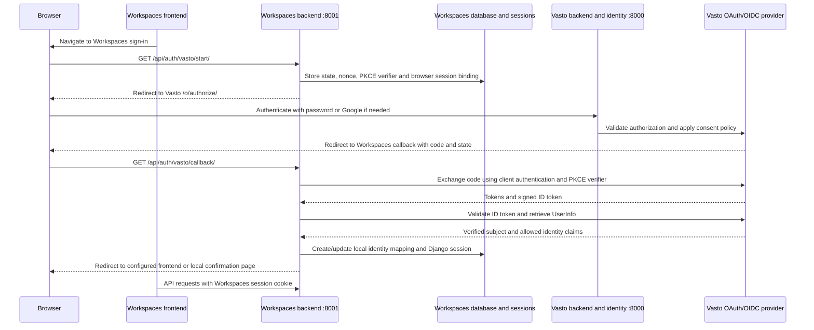

# Vasto as the Workspaces OpenID Connect provider

This guide describes the Vasto side of the Vasto Workspaces sign-in integration. It is for backend developers configuring Vasto as an OAuth 2.0 and OpenID Connect (OIDC) provider.

> **Implementation status:** The provider and local Workspaces client are implemented. The local application record and provider settings have been inspected. Full end-to-end verification depends on both local services and valid developer credentials.

## Contents

- [Architecture](#architecture)
- [Run Vasto locally](#run-vasto-locally)
- [Provider endpoints and settings](#provider-endpoints-and-settings)
- [Register Workspaces as a client](#register-workspaces-as-a-client)
- [Signing keys](#signing-keys)
- [Scopes and identity claims](#scopes-and-identity-claims)
- [Login, consent, and grants](#login-consent-and-grants)
- [Test the provider locally](#test-the-provider-locally)
- [Troubleshooting](#troubleshooting)
- [Related documentation](#related-documentation)

## Architecture

Vasto is the central identity provider. It owns user accounts, password and Google authentication, and the decision to authorize an OAuth client. Workspaces is a separate Django application and confidential OAuth client. It does not ask users to create a second password.

The applications use separate databases and separate browser sessions. After Vasto authenticates a user and issues an authorization code, Workspaces validates the OIDC response, maps the Vasto `(issuer, subject)` identity to a local Workspaces user, and starts its own Django session. Workspaces does not use Vasto's session cookie to authenticate its API requests.



The browser carries the authorization redirect. The Workspaces backend holds the client secret and performs the code exchange. Vasto authenticates the person and grants the client only the scopes approved by the user and provider policy.

## Run Vasto locally

### Prerequisites and settings

Vasto documents Python 3.11 or newer and its Docker image uses Python 3.11. Local Django commands use `pwaninet.settings.local`; the project defaults to `pwaninet.settings` through `manage.py`, which selects local settings unless explicitly running in production. The settings load the repository-root `.env` using `python-dotenv`.

From the Vasto repository root:

```sh
python --version
python -m venv .venv
source .venv/bin/activate
python -m pip install --upgrade pip
python -m pip install -r requirements.txt
cp .env.example .env
```

Set local PostgreSQL values in `.env` (`DB_NAME`, `DB_USER`, `DB_PASSWORD`, `DB_HOST`, `DB_PORT`) and keep credentials local. The checked-in `docker-compose.yml` and `.env.example` both use host port **5432**. Keep `DB_HOST=127.0.0.1` for local development to avoid `localhost` resolving to IPv6 when PostgreSQL only accepts IPv4. If you change the Compose port mapping or connect to another PostgreSQL service, make `DB_PORT` match that service's published port.

Start the local database and Redis:

```sh
docker compose up -d db redis
```

Then migrate, create an administrator, and start Vasto on the browser-facing loopback address:

```sh
python manage.py migrate --settings=pwaninet.settings.local
python manage.py createsuperuser --settings=pwaninet.settings.local
python manage.py runserver 127.0.0.1:8000 --settings=pwaninet.settings.local
```

Keep `127.0.0.1` consistent for both services. Do not browse to `0.0.0.0`; that is a bind address, not the local browser origin. Do not alternate between `localhost` and `127.0.0.1`: browser cookies are host-scoped, even though ports differ.

Redis is started by Compose. Local settings configure Celery to use Redis database 0 and cache settings may use different Redis settings; Redis is also used by other Vasto features. OAuth provider endpoints themselves are served by Django.

### Local versus production

Local development uses `pwaninet.settings.local`, PostgreSQL, HTTP redirect URIs, and issuer `http://127.0.0.1:8000/o`. Production uses `pwaninet.settings.production`, PostgreSQL, HTTPS redirect URIs, secure cookies, and issuer `https://pwaninet.app/o` (the service's existing domain). Keep client registrations and credentials separate for local, staging, and production.

## Provider endpoints and settings

Vasto installs `oauth2_provider` and includes `oauth2_provider.urls` under `/o/` in `pwaninet/urls.py`. The OIDC discovery metadata is exposed by Django OAuth Toolkit (DOT). The local URLs are:

| Purpose | Local URL |
|---|---|
| Authorization | `http://127.0.0.1:8000/o/authorize/` |
| Token exchange | `http://127.0.0.1:8000/o/token/` |
| UserInfo | `http://127.0.0.1:8000/o/userinfo/` |
| OIDC discovery | `http://127.0.0.1:8000/o/.well-known/openid-configuration` |
| JWKS | `http://127.0.0.1:8000/o/.well-known/jwks.json` |

The production issuer is `https://pwaninet.app/o`; the local settings override it with `http://127.0.0.1:8000/o`. The issuer published in discovery must exactly match the `iss` claim in each ID token and Workspaces' configured `VASTO_ISSUER`. A mismatch is an authentication failure.

Clients should load discovery metadata from the configured discovery URL. It publishes the issuer and endpoint locations and signing-key location in one place, reducing endpoint drift between clients and providers. Workspaces uses that metadata for authorization, token, UserInfo, and JWKS locations, then explicitly compares its issuer setting with metadata and the ID token.

The inspected provider settings configure:

| Setting | Current behavior |
|---|---|
| `OIDC_ENABLED` | Enabled. |
| Signing algorithm | Application is registered for RS256; the provider has an RSA private key setting. |
| Supported scopes | `openid`, `profile`, `email`. |
| Response type | Authorization Code (`code`). |
| Grant types | Authorization Code and Refresh Token. |
| Token endpoint authentication | `client_secret_basic`. |
| PKCE | Required, with S256 required by the Workspaces client. |
| Local redirect schemes | `http` and `https` in local settings. |
| Production redirect schemes | HTTPS only. Exact redirect URI matching is enabled; wildcards are disabled. |
| Access token lifetime | 7,200 seconds (2 hours). |
| Refresh token lifetime | 2,592,000 seconds (30 days), with rotation and reuse protection enabled. |
| Authorization code lifetime | 600 seconds (10 minutes). |
| Approval policy | `REQUEST_APPROVAL_PROMPT = 'auto'`. See [Login, consent, and grants](#login-consent-and-grants). |

The OIDC discovery endpoint and the JWKS endpoint are generated by DOT, not custom views in this repository. JWKS publishes public key material only; the signing private key must never be sent to Workspaces.

## Register Workspaces as a client

Register the client in Vasto Django admin at `/admin/` → **OAuth2 Provider** → **Applications** → **Add application**. Use a separate application record in each environment. For field behavior and secret hashing, see the [Django OAuth Toolkit 3.4.1 admin guide](https://django-oauth-toolkit.readthedocs.io/en/stable/tutorial/tutorial_admin.html).

The inspected local Workspaces record is:

| Field | Local example | What it controls |
|---|---|---|
| Name | `Vasto Workspaces (Local)` | Human-readable admin label. |
| User | An administrator/owner account | Admin ownership and audit context; it is not the user who will sign in. |
| Client type | Confidential | The client can keep a secret on its backend. Do not put that secret in React/browser code. |
| Authorization grant type | Authorization code | The browser receives a short-lived code; the backend exchanges it for tokens. |
| Redirect URIs | `http://127.0.0.1:8001/api/auth/vasto/callback/` | Exact browser callback allowlist. Scheme, hostname, port, path, and trailing slash must match. |
| Post logout redirect URIs | Not used by the current Workspaces integration | There is no implemented global or RP-initiated logout flow. Leave unset unless that capability is separately designed. |
| Skip authorization | Unchecked (`False`) | Allows the provider consent policy to require approval for a new grant. |
| Algorithm | RSA with SHA-2 256 (RS256) | ID-token signing algorithm. |
| Hashed client secret | Enabled on the inspected local registration | The stored secret is not a secret-recovery mechanism; preserve the raw value securely when it is issued. |
| Allowed origins | Not needed for this server-side callback integration | This is not a substitute for frontend CORS configuration. |
| Registration source | `manual` for an admin-created Application | DOT metadata distinguishing admin-created clients from dynamic registrations; it does not affect this Workspaces flow. |

After creating the record, copy the raw client ID and secret into the Workspaces backend's local `.env` as `VASTO_CLIENT_ID` and `VASTO_CLIENT_SECRET`. Store them only in the backend environment or secret manager. Never paste the secret into frontend configuration, tickets, logs, documentation, or source control. `.env` is ignored by Git.

Use different client IDs, secrets, callback URIs, and issuer settings for local, staging, and production. Never promote local credentials to production.

### Rotate a client secret

When a client secret is exposed, edit that specific Application in Django OAuth Toolkit admin and set a new secret. Copy the new plaintext value before saving; with **Hash client secret** enabled it cannot be shown again after save. Update the corresponding Workspaces backend secret store and restart/reload that backend. Secret rotation changes future client authentication; it does not itself revoke already-issued access tokens or refresh tokens. If tokens may also be exposed, use DOT's Access tokens or Refresh tokens admin actions to revoke only the affected records (revoking one also revokes its paired token), or use the authenticated revocation endpoint. Do not delete unrelated applications' tokens. See the [DOT 3.4.1 admin guide](https://django-oauth-toolkit.readthedocs.io/en/stable/tutorial/tutorial_admin.html) and [Application model reference](https://django-oauth-toolkit.readthedocs.io/en/latest/models.html).

## Signing keys

Vasto signs OIDC ID tokens with RS256. Workspaces verifies those signatures using public keys published through the discovered JWKS endpoint. The private key stays in Vasto and is never shared with Workspaces.

The `OIDC_RSA_PRIVATE_KEY` setting reads PEM text directly from the environment when provided; otherwise it loads `.secrets/oidc_rsa_private.pem` under the Vasto repository root if that file exists. `.env.example` documents these options. For a local development key, create the ignored secret directory/file:

```sh
mkdir -p .secrets
openssl genrsa -out .secrets/oidc_rsa_private.pem 4096
```

Keep the key stable across restarts. Replacing it changes the signing key; coordinate any key rotation with client JWKS caching and token lifetime. Production key material should be supplied through the production secret-management mechanism, with access restricted to the Vasto service. Never commit the key or include it in a support request.

## Scopes and identity claims

Vasto configures only these scopes for this integration:

| Scope | Meaning |
|---|---|
| `openid` | OIDC authentication and the stable subject (`sub`). |
| `profile` | Profile claims allowed by the provider's scope-aware OIDC behavior. |
| `email` | Email-related claims. |

`users/validators.py` supplies `preferred_username`, `email`, `email_verified`, `given_name`, and `family_name` as additional claims. With `OIDC_COMPLIANT_SCOPE_CLAIMS=True` and the Authorization Code response (which includes an access token), profile/email claims are returned by UserInfo rather than copied into the ID token. The toolkit's subject claim is present in the signed ID token and UserInfo. Workspaces verifies `iss` and `sub` from the signed ID token, then obtains `preferred_username`, `email`, and `email_verified` from UserInfo and confirms its `sub` matches. The current Workspaces mapping does not store `given_name` or `family_name`.

| Claim | Source used by Workspaces | Scope / handling |
|---|---|---|
| `iss` | Signed ID token | Must match configured issuer exactly. |
| `sub` | Signed ID token and UserInfo | Stable provider subject; Workspaces requires a match. |
| `preferred_username` | UserInfo | Profile claim; used for the local username snapshot. |
| `email` | UserInfo | Email claim; may be empty. |
| `email_verified` | UserInfo | Email claim; Workspaces stores `true` only for Boolean `true`. |
| `given_name`, `family_name` | Can be supplied by Vasto | Not consumed or persisted by current Workspaces code. |

`sub` is the stable provider identity. Workspaces maps a person by the pair `(issuer, subject)`, never by email or username alone. Profile image, bio, institution/school, course/programme, and other student profile data are not part of the Workspaces identity contract yet.

## Login, consent, and grants

Authentication proves the user's identity to Vasto. Authorization is the user's approval for a client to receive the claims associated with requested scopes. They are separate steps.

The Workspaces Application has `skip_authorization=False`. A first-time user who starts Workspaces authorization and needs to sign in is redirected to Vasto login; after successful password or Google authentication, Vasto resumes the original `/o/authorize/` request and displays the standard DOT consent form when approval is needed. Login continuation preserves the authorization query, including state, nonce, and PKCE values; the request is validated as a same-host redirect. Google Identity Services keeps its configured callback URI fixed and stores continuation context server-side behind a short-lived signed reference.

The current provider policy is `REQUEST_APPROVAL_PROMPT='auto'`. Under DOT 3.4.1, a previously authorized, unexpired grant for the same user, application, and requested scopes can be approved automatically. This is remembered consent. It is why ordinary Workspaces sign-in can continue without showing consent again. It does not mean user authentication was skipped. New requested scopes or a missing/expired/revoked grant require approval according to the normal provider flow.

The recent continuation repair carries the pending authorization through Vasto login and account creation. Regression tests cover password login, signup continuation, and consent. The test run could not be completed in the current shared environment because the available Python environment lacks Vasto's `celery` dependency; treat that repair as implemented but not fully verified here.

Workspaces logout ends only the Workspaces Django session. It does not revoke the Vasto grant or log out of Vasto. There is no global single logout. To require a new approval, revoke the Workspaces user's grant/tokens for the Workspaces Application using DOT administration or revocation, then start authorization again. Scope elevation and step-up TOTP approval are not implemented as separate features; additional TOTP verification at authorization time is a future enhancement.

## Test the provider locally

1. Start PostgreSQL and Redis with `docker compose up -d db redis` and confirm `.env` database settings match the Compose host port.
2. Start Vasto at `http://127.0.0.1:8000` using `pwaninet.settings.local`.
3. Check discovery and JWKS. These requests should return JSON; no credentials are needed for the public metadata:

   ```sh
   curl -fsS http://127.0.0.1:8000/o/.well-known/openid-configuration
   curl -fsS http://127.0.0.1:8000/o/.well-known/jwks.json
   ```

4. In Django admin, create the confidential local Workspaces Application described above. Configure the client secret in Workspaces' `.env`; do not send it to the browser.
5. Start Workspaces and open `http://127.0.0.1:8001/api/auth/vasto/start/` in a browser. This initiates the real authorization request with state, nonce, and PKCE S256.
6. Sign in to Vasto. For a new grant, review and approve the standard consent form. The browser returns to the exact registered Workspaces callback URI.
7. Workspaces exchanges the one-time code server-to-server using `client_secret_basic` and the saved PKCE verifier. Do not copy authorization codes or tokens into logs or documentation.
8. Verify the Workspaces session with `GET http://127.0.0.1:8001/api/auth/me/`. Verify UserInfo and identity mapping through the Workspaces backend; do not attempt to use a browser access token as a substitute for its server-side callback.

The OAuth Application, user, database, and signing key used for development must be local/test resources. Never revoke production grants while following this walkthrough.

## Troubleshooting

| Symptom | Verified cause or diagnostic | Resolution |
|---|---|---|
| `redirect_uri` rejected | The callback is not an exact match for the Application allowlist, or local HTTP/production HTTPS policy is crossed. | Register the exact callback including trailing slash; use `127.0.0.1:8001` locally and HTTPS in production. Wildcards are disabled. |
| Provider errors because no RSA key is configured | Neither `OIDC_RSA_PRIVATE_KEY` nor `.secrets/oidc_rsa_private.pem` is available. | Configure a stable local private key or production secret. Never share it with Workspaces. |
| Discovery issuer differs from Workspaces | Workspaces `VASTO_ISSUER` and the issuer in discovery/ID token use different scheme, hostname, path, or environment. | Align the values exactly: local `http://127.0.0.1:8000/o`; production `https://pwaninet.app/o`. |
| `/o/...` returns 404 | OAuth Toolkit URL inclusion is missing in the running code/revision, or the request is sent to the wrong server/base path. | Confirm Vasto runs the expected revision and inspect the `/o/` URL configuration. |
| Login succeeds but authorization does not resume | A login/signup path dropped `next`, or the continuation was unsafe/expired. | Preserve the local `/o/authorize/` continuation through login, signup, Google, and 2FA; do not manually rebuild OAuth state, nonce, or PKCE. The current login/signup code carries the validated continuation. |
| Google reports `invalid_request` | The Vasto login page had appended the OAuth `next` query to Google's GIS `login_uri`, so the Google POST target no longer exactly matched the configured Authorized redirect URI. | Keep the fixed Google callback URI registered with Google; carry the continuation using the existing short-lived opaque GIS state reference. The Workspaces OAuth redirect belongs only in Vasto's OAuth Application. |
| Consent does not appear | The matching Workspaces user/application/scopes already have a valid grant and provider policy is `auto`, or the application has skip authorization enabled. | Check only the relevant local user's grants and that Application's `skip_authorization=False`. Revoke only the local test grant if first-consent testing is needed. |
| A callback says authorization transaction is invalid/expired | Workspaces transactions are bound to the initiating browser session, expire after 10 minutes, and are single-use. | Restart from `/api/auth/vasto/start/` in the same browser session. Do not refresh/replay an old callback. |
| Browser appears to share or overwrite a login between local apps | Cookies share hostname scope across ports; earlier use of identical cookie names can collide. | Use `127.0.0.1` consistently and the distinct local cookie names: `pwaninet_local_sessionid` for Vasto and `workspaces_sessionid` for Workspaces. Clear stale `localhost`/`127.0.0.1` cookies if needed. |
| Local DB connection refuses | The database service is stopped, or `.env` uses a host/port that does not match the PostgreSQL service. | Start PostgreSQL and Redis with `docker compose up -d db redis`; use `DB_HOST=127.0.0.1` and the published Compose port (`DB_PORT=5432` by default). |

## Related documentation

The separate Workspaces repository contains `docs/authentication/vasto-oidc-client.md`, covering its client implementation and API contract. React setup and frontend implementation are maintained separately by the frontend team.
