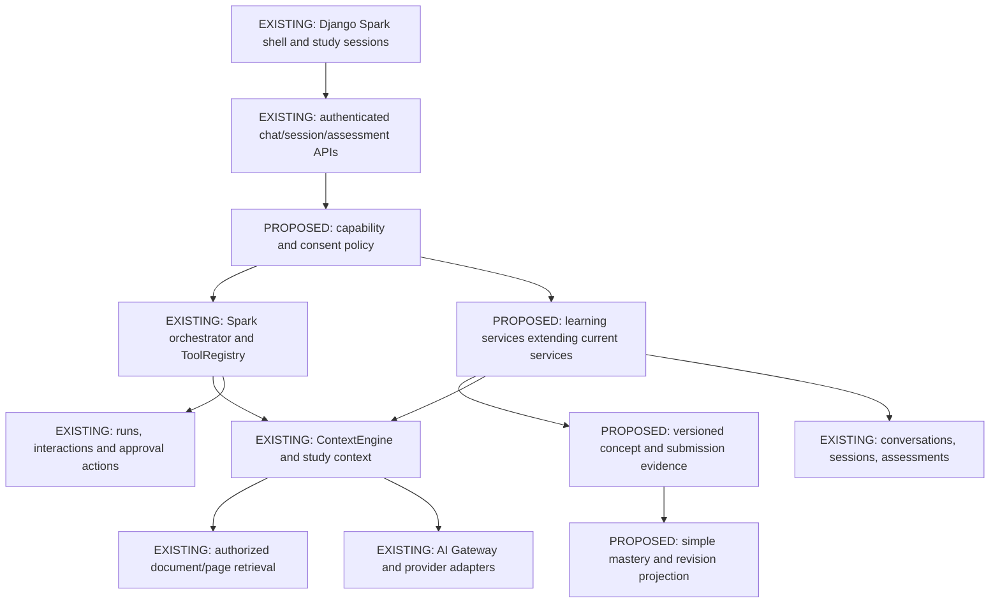

# Recommended SALS architecture inside PwaniNet

11 November 2026 · Proposal only, no application changes. Existing evidence and risk IDs: [audit](SALS_EXISTING_SYSTEM_AUDIT.md). Module-by-module dependencies, event/disable/test contracts: [matrix](SALS_CAPABILITY_MATRIX.md).

## Decision

Extend the existing Spark monolith with a small learning domain and capability policy. Keep its conversation, session, context, document retrieval, tool registry, gateway and frontend. Do not create an independent agent, orchestration system, microservice or Workspaces dependency. Existing `AssessmentService`, `StudySessionService`, `StudyMemoryService`, `ToolRegistry` and `DocumentTurnContext` already implement much of the necessary foundation.

## Existing versus proposed integration

Existing components and exact symbols: `pwanimate/orchestrator/service.py:PwanimateOrchestrator`; `tools/registry.py:ToolRegistry`; `context/engine.py:ContextEngine`; `services/study_session.py:StudySessionService`; `services/assessment.py:AssessmentService`; `ai/gateway/gateway.py:AIGateway`; `services/agent_execution.py:claim_run`; `services/actions.py:ActionService`; `orchestrator/document_context.py:DocumentTurnContext`.

## Boundaries and contracts

The following interfaces are **proposed**, not located code. Fit them alongside existing services; names and file placement are implementation decisions.

| Proposed contract | Inputs and outputs | Enforcement |
|---|---|---|
| CapabilityPolicy.resolve(actor, unit, session) | Allowed capability set and reason codes | Configuration + user consent; server API, tool dispatch and jobs recheck; never trust hidden UI |
| LearningSpace.open(actor, unit_ref, goal) | Existing owned session + chosen canonical unit/custom label | Explicit unit ambiguity handling, allowed enrollment/catalog policy; reopening idempotent |
| Roadmap.propose/approve(actor, session, version, items) | Versioned objectives/concepts and source manifest | Proposal does not change accepted roadmap; approval tied to exact version |
| Tutor.context(actor, session, concept, sources) | Bounded addition to existing StudyOrchestrationContext | Current evidence/uncertainty, recent turns, authorized sources; no private fact dump |
| Assessment.create(actor, session, concept_version, source_refs, format, request_key) | Existing assessment public payload | Strict shape/key validation, source provenance, quota attribution, idempotency |
| Assessment.submit(actor, assessment, question, answer, request_key, expected_version) | Durable evaluation + key-safe feedback + evidence identity | Resolve owner; grade outside locks; short atomic finalization; explicit inconclusive state |
| Mastery.project(actor, unit, concept, policy_version) | Evidence count/coverage, state, confidence and revision due | Deterministic from eligible outcomes; practice separated; unknown until sufficient evidence |
| Planner.propose/confirm(actor, proposal_id, decision) | Approved learning-session action using current approval infrastructure | Exact unit/goal/time approved; denial/expiry/replay safe |

A common envelope should carry authenticated actor, request ID/idempotency key, session/conversation IDs, concept/objective version and source IDs/version/page. Actors are never model-supplied. Public outputs use `public_assessment/public_question` rather than raw keys. Grade correctness, key confidence and learning mastery are separate facts. A source-backed question still requires a valid answer key.

## Integration seam and routing constraint

The existing registry is a good execution surface for approved SALS tools, but is insufficient alone. `PwanimateOrchestrator.run` excludes study and attachment/context requests from its initial planner path (`service.py:981`). Keep existing routing initially: provide study context via `StudySessionService.build_study_orchestration_context`, expose typed commands through existing assessment/session APIs, and have conversational proposals map to explicit approved actions. Only broaden planner admission later with compatibility tests for documents/vision/study; do not silently route every study turn through a new loop.

`PwanimateOrchestrator` already owns final generation and provider selection. Proposed tutoring services prepare bounded data/policies; they do not implement their own tool/LLM loop. Question writing and optional explanation grading continue through AIGateway with actor/task metadata, strict output schemas and budget controls. For maths MVP, use narrow validated MCQ/numeric question types with known-valid keys and deterministic validation; arbitrary symbolic or handwritten grading is deferred. Do not execute arbitrary student expressions as code.

## Capability registration and optional modules

Introduce one declarative capability descriptor with identifier, prerequisites, associated tool names/API actions, user-consent requirement and disabled behavior. Validate unknown capabilities and dependency cycles on startup. Policy should fail closed for writes if prerequisites are disabled, and return machine-readable unavailable reasons. Use configuration/service composition inside Django, not a runtime plugin package installer.

Shared nonoptional foundation: authentication/ownership; document authorization; transcript/session persistence; key secrecy; consent enforcement; gateway contracts/accounting; atomic evidence storage; migration compatibility. Optional: unit dashboards, roadmap proposals, tutoring strategy, assessments, automatic mastery projection, assignments, revision reminders, memory recall, autonomous session planning and paper analysis. The shared document viewer/retrieval remains available to ordinary Spark even if SALS document analysis is off.

Existing `SPARK_AGENT_ENABLED` disables the general planner loop, not every existing Spark capability. Do not overload it as the SALS master switch. A SALS flag turns off new capabilities; old chat and owner-readable learning data continue. Every API/action/job rechecks effective policy, including an action proposed while enabled but confirmed after disablement. Assessment off blocks new generation/submission, but existing results remain readable. Mastery off freezes projections with an explicit paused/stale label while retaining evidence. Re-enable rebuilds under a versioned policy rather than silently altering historic reports. User-requested deletion remains explicit and separate from disablement.

## Events and transactions

Start with service calls plus small in-process events such as answer.evaluated, roadmap.approved, concept.state_changed, review.due and session.approved. These are proposed semantic events, not current SparkAgentEvent types. Record evidence transactionally, update or schedule projection safely, and emit notification work after commit. Consumer failures must not erase submissions or duplicate assessments. Use existing Celery/notifications for noncritical background work; add an outbox only if durable cross-transaction delivery is actually required. Keep run activity/checklist events as UI progress, never use them to award marks.

Concurrent grading needs a validated request/version claim, external model evaluation outside a DB lock, and a short atomic compare-and-write against the claim. Different question submissions must not overwrite each other. Repeated idempotency keys return the original result. Changing goals creates a new evidence scope; old assessment data remains readable but cannot re-credit the new goal.

## Data and implementation restraint

Use existing sessions as the first learning-space container. Add stable concept/objective versions and answer evidence only after correcting current score semantics; do not create a duplicate Conversation, Document, Unit, Quiz or generic Memory model. Keep summaries/observations clearly separate from confirmed evidence. Merge Teaching/Understanding implementation into a small tutoring service; separate Assessment from Mastery policies; postpone Assignment Engine and automated multi-paper mock exams.

Compatibility requires additive migrations, legacy read fallbacks, preserved UUIDs, existing JSON response fields and explicit schema versions for new contracts. No migration should infer mastery from old summaries or existing accuracy percentages. Review the pre-existing untracked migrations with actual deployment state before implementation; do not assume a fresh DB or renumber migrations in this audit.

## Verification

Tests should exercise capability disabled combinations, policy denial at API/tool/job, source revocation, owner isolation, exact proposal approval, transcript compatibility, partial/malformed generation, deterministic mathematical fixtures, idempotency, concurrent submissions, target version changes and migration preservation. Browser checks cover sequential assessment Send/error/reload, SSE interruption, page IDs and mobile/dark/light behavior. Measure model pedagogy separately from backend invariants using a small reviewed determinant/inverse corpus. See [MVP plan](SALS_MVP_IMPLEMENTATION_PLAN.md) for dependency gates.
