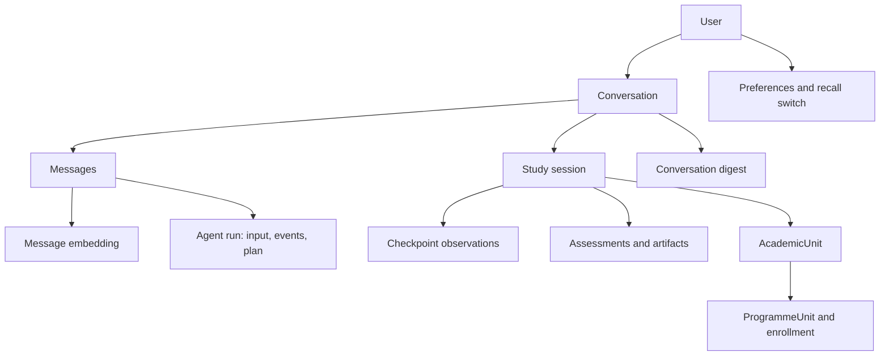

# SALS data, memory, ownership and consent audit

11 November 2026 · PwaniNet only · Current working-tree source, not a deployed-schema certification. Read alongside [existing-system audit](SALS_EXISTING_SYSTEM_AUDIT.md).

## Three distinct information classes

| Class | Existing records and access path | What is established | What it must not imply |
|---|---|---|---|
| A: Conversation history | PwanimateConversation(user), PwanimateMessage(conversation); ConversationService.get_owned_conversation/load_history | Owner-scoped transcript and bounded active-conversation context | Keeping a transcript is not consent to extract reusable personal facts |
| B: Personal long-term memory | PwanimatePreferences stores explicit settings; SparkConversationDigest summarizes conversations; PwanimateMessageEmbedding indexes transcript; SparkMemoryPreference gates cross-chat recall | Preferences and owner-scoped semantic/lexical recall exist | No approved fact-by-fact store, sensitivity classification or individual fact edit/delete workflow was found |
| C: Academic learning records | PwanimateStudySession(user, conversation, unit), checkpoints, SparkAssessment(user, session), SparkStudyArtifact(user, session) | Persistent session state, observations, answer outcomes and reports | A digest or substantive message is not validated mastery; chat mode alone should never update grades |

Evidence: `pwanimate/models.py:210,248,348,519,788,942,1128,1134,1183,1217`; `services/conversation.py`; `services/conversation_memory.py`; `services/study_memory.py`; `services/assessment.py`; `services/study_report.py`.

## Existing relationships

Conversation → session and conversation → digest are one-to-one. Sessions reference a latest checkpoint. User-scoped FK duplication in assessments/artifacts/embeddings is helpful for filtering, but no cross-table DB constraint establishes that their user equals the related session/conversation owner. Existing API/service constructors generally set those values together; every future background/import/admin path must maintain the same invariant.

## Authorization findings

| Surface | Confirmed controls | Gap / minimal change |
|---|---|---|
| Chat and conversation detail | IsAuthenticated; ConversationService owner filter; explicit study-session/conversation match (`api/views.py:_post_chat`, ConversationDetailView) | Maintain uniform not-found behavior; never accept conversation ID as permission |
| Study session APIs | StudySessionService.get_owned_session; metadata uses owner filter with row lock | Helpers accepting session instances assume trusted callers; resolve owner at each external boundary |
| Assessment APIs | AssessmentView._session filters user, answer lookup additionally filters session and user | Service accepts an assessment object, so require trusted owner-resolved object; add transactional/versioned outcome writes |
| Message recall | `ConversationMemoryService.search` filters embedding.user AND message.conversation.user; lexical fallback filters owner | Query memory currently mixes personal and academic chats for the same person; add purpose/scope controls |
| Digests/forget | Digest retrieval filters conversation owner; forget locks preference, deletes digests and embeddings, records reset_at; refresh locks/rechecks consent after model returns | enabled defaults True; no per-fact approval or TTL. Decide defaults, separate facts/academic continuity, handle delayed jobs and re-enable semantics |
| Attachments | Upload/status/media endpoints in api/views.py filter owner; context attachment resolver receives authenticated user | Recheck when restoring, opening and generating source-derived outputs; storage URL revocation runtime not tested |
| Agent runs/events/interactions | AgentRunView user filter; journal.events_after receives user; claim_run locks owned run; interaction resolve validates stored contract | Keep state snapshots private, exclude answer keys from events; global stale recovery on read is a stateful operation, not a diagnostic to execute during audit |
| Documents: vectors/pages | Authorized candidate queryset before distance; page resolver reuses auth; DocumentTurnContext rejects conflicting IDs | Multiple policy implementations differ; consolidate policy without widening access |
| Documents: elevated roles | Both page/semantic/search allow staff, superuser, PRESIDENT and DELEGATE to read other users' non-AI private documents | This is confirmed policy behavior; whether intentional needs owner decision. Do not describe private as owner-only under current rules |
| Restricted documents | Programme and/or direct enrollment checks in semantic/page code | Search metadata branch lacks direct enrollment; legacy course fallback differs; require a common candidate policy |
| Saved document inventory | Owner's collection, ready/available document filters (`services/study_materials.py:saved_document_inventory`) | Collection membership is not current read authority; title/share/unit metadata could remain after permission revocation. Filter through current document policy |
| Academic/unit scope | Enrollment and institution/timetable relationships exist | Catalog lookup global; numeric ID resolution not explicit; unit_scope based on code/custom label. Decide allowed browsing versus enrollment and resolve unambiguously |

Supporting source: `pwanimate/services/study_session.py:is_user_authorized_for_document` (:208); `retrieval/services/document_retrieval.py:build_authorized_chunk_queryset`; `search/services/unified_search_service.py:_build_document_queryset` (:489); `retrieval/adapters/pwaninet_search.py:search_documents_lexical`; `services/personal_planner.py:resolve_unit/unit_scope_for`; `tools/domain/academic.py`.

No cross-user conversation IDOR was established in the inspected entry points. Broad role-based document access is real, not a hypothetical bypass; do not label it an exploit until intended policy is confirmed. Unit filtering is a relevance constraint as well as a product boundary, distinct from document authorization. Hybrid metadata results currently do not inherit academic_unit/category filters from RetrievalRequest, so a unit-specific result can include other authorized units even when no private data is leaked.

## Consent and retention semantics

`SparkMemoryPreference.enabled` defaults True. `ConversationService.persist_user_message/persist_assistant_message` schedules indexing, and assistant persistence schedules digest generation. `tasks/conversation_memory.py:embed_message` checks preference/reset cutoff before processing and again under lock before success. `StudyMemoryService.refresh` likewise rechecks after LLM generation. These are useful race protections, not evidence of opt-in. The embedding task's failure path writes failed status outside that final consent lock; late-failure-after-forget behavior needs an explicit regression test rather than an unconditional guarantee.

Memory PATCH toggles global recall/extraction; it does not clear saved digests, transcripts, assessments or current-session checkpoints. Memory DELETE deletes digests/vectors and sets cutoff, explicitly returning `chat_history_deleted=False`. It does not delete learning records. Memory GET lists stored summaries even while disabled, which is reasonable for user inspection but must be explained. Existing session continuity can still use the same conversation/checkpoints while cross-conversation recall is off. Consent text must make that distinction understandable.

No automatic personal memory expiration, TTL, selective fact approval, purpose-specific consent or automatic academic evidence retention policy was found. Deleting conversation cascades through session/assessments/digest and message references, so it may also remove learning evidence; existing UI deletion semantics and future export/deletion guarantees need product review. SET_NULL on session.unit preserves session history if a unit is removed, but labels/scope must not become new access authority.

Privacy risks also include transmission to external embedding/LLM providers when recall/digests are generated, retained provider errors and raw user query snippets in the planner fallback log (`orchestrator/agent.py`, query=%.120r). No runtime logs or secrets were read. Review output sanitization and provider retention configuration separately with appropriate access.

## Learning evidence weaknesses

1. `StudySessionService._sanitize_demonstrated_concepts` rejects passive/short text, but can match a missing evidence ID to a latest substantive message. It validates provenance heuristically, not correctness or semantic relation. A wrong detailed answer can become a “verified” observation. Keep it explicitly unverified until assessment evidence supports it.
2. `AssessmentService.submit_answer` accepts a loosely parsed LLM boolean; `bool('false')` is True. MCQ keys generated by the LLM may be empty/wrong or absent from options. Out-of-options answers can invoke LLM grading. Strict schemas and reviewed/deterministically verified keys are required.
3. `_recompute_mastery` is accuracy across graded items, including incomplete assessments; one correct/four unanswered produces 100 in a source-method probe. It ignores concept coverage, difficulty, independence, recency and evidence quantity.
4. `set_target` resets mastery/roadmap but old counted assessments remain and recomputation includes them. Target-set time currently does not partition assessment evidence.
5. JSON item mutation and separate score recomputations have no atomic multi-writer guard. Question IDs permit lookup but are not an immutable answer ledger or concurrency control.

## Minimum proposed additions, only after approval

Do not merge transcript, personal memory and learning evidence tables. Keep existing conversations/sessions/assessments and add only data needed to enforce trustworthy evidence:

| Proposed relationship/field | Gap it addresses | Preservation strategy |
|---|---|---|
| Roadmap/objective version with stable concept IDs, session/unit association | Labels and array indices cannot reliably link question outcomes across edits/goals | Preserve old JSON and target; label old entries as legacy, never infer mastery during backfill |
| Submission/evaluation linked to assessment/question, concept/version, source, grader and policy version | Auditability, retries, evidence quantity and target reset | Append immutable submissions; unique request identity; existing questions readable as legacy evidence |
| Concept learning state derived from eligible evidence | Honest concept progress and due revision | Rebuildable projection with unknown/insufficient-evidence state; no migration of legacy accuracy to certified mastery |
| Approved personal fact + consent provenance, only if product wants fact memory | Existing recall is transcript search, not approved facts | Explicit approval and individual forget/update; prevent academic graders from reading personal facts |
| Separate recall/personal-fact/academic-continuity choices and consent version/time | Global enabled flag conflates purposes | Existing history preserved; retain old choice provenance; do not silently opt in existing users |
| Optional revision due metadata | Retention workflow absent | Reuse planner notifications for delivery after user opts in |

These are proposed conceptual relationships, not final table names or migrations. Start with a versioned JSON contract only where it still permits unique/atomic evidence writes; normalize submissions if concurrency and auditability require it. New consent or evidence records must be owner-linked and validated against session/conversation ownership. Store stable source IDs and versions, not unrestricted copies of private material in public resources.

## Required security and retention tests

Use isolated synthetic users, never production records. Cover all endpoints with user A/user B, staff, executive roles, public/restricted/private and generated documents. Repeat through vector, lexical, exact-page, source inventory, preview/download and restored-session paths. Test revoked enrollment/collection access and inactive documents; unknown unit filters must fail closed. Cover memory off/forget before, during and after job execution and on failure; opt-in after reset must not re-index older turns. Test interaction/session/conversation mismatches, event replay ownership, hidden answer keys, duplicate submits and target changes. Check that personal conversation messages cannot create assessment evidence without an explicit assessment/submission.

Product decisions: who may read private non-AI documents; which memory defaults/approval granularity apply; whether deleting a conversation deletes learning records; separate export/retention periods; whether custom or unenrolled units are allowed. No data was queried or changed to resolve these decisions.
