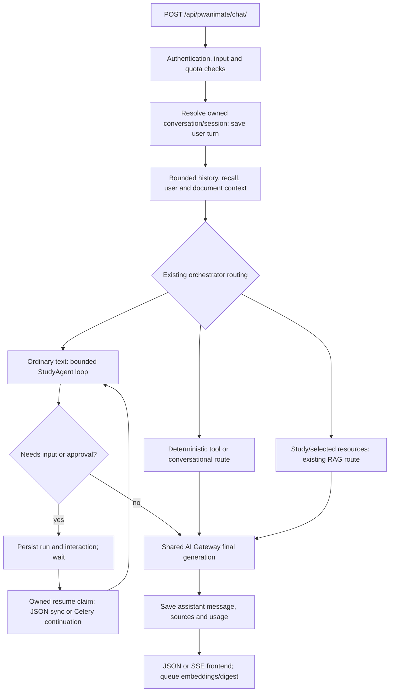

# Spark SALS existing-system audit

Date: 11 November 2026. Scope: Spark inside PwaniNet only. Repository: `/home/zayne/projects/pwaninet`; base HEAD `6084e059d43e2aca15a84d6a48c77b3fd3feb40c`. This report describes the **current working tree**, including substantial pre-existing modified and untracked code. It does not establish what is deployed or which migrations have been applied. No Workspaces architecture is included.

## Method and evidence limits

Read-only source inspection covered Spark models, API/UI routes, orchestration, tools, context, providers, memory, study services, document ingestion/retrieval, academic models, frontend, migration inventory and selected definitions, and representative tests/documentation. `rg` is unavailable; `find`, `grep`, `sed` and Python AST inspection were used. No settings module or Django application was imported; no database, broker, provider, or user content was accessed. Existing Django tests were inspected, not executed: test setup may create databases, apply migrations or dispatch integrations. Two isolated in-memory probes below used no application imports or external calls. Source references identify repository-relative paths and symbols; numbered anchors refer to this working tree and can move.

“Implemented and verified” in the companion matrix means source-confirmed application behavior, with the verification mode stated; it does **not** imply integration tests passed. Product behavior depending on a model, live infrastructure, or UI interaction remains partial, prompt-dependent or unable to determine.

## 1. Request lifecycle

Public mounts: `pwaninet/urls.py:410` and `:411`, UI `/pwanimate/`, API `/api/pwanimate/`. DRF defaults in `pwaninet/settings/base.py:263` use SessionAuthentication and TokenAuthentication; `PwanimateChatView` additionally requires IsAuthenticated.

Evidence: `pwanimate/api/views.py:PwanimateChatView.post`, `_stream_chat_response`, `_post_chat` (190–880); `ConversationService.get_owned_conversation`, `load_history`, persistence methods in `pwanimate/services/conversation.py`; `PwanimateOrchestrator.run` (`pwanimate/orchestrator/service.py:922`), `_run_rag:1590`, `_run_tool:1317`, `_run_conversational:1210`, `finish_agent:1055`.

The API resolves `study_session_id` with owner filtering and rejects mismatching conversation IDs. Explicit creation of a client-chosen UUID checks for collisions. Attachments are linked to persisted turns. Study mode uses server history; normal mode retains a legacy client-history fallback only on a new conversation without server history. User text is persisted before generation, so a failed turn can remain unanswered and be retried.

`ConversationService.load_history` defaults to ten messages/1,500 estimated tokens, prefetched attachments, pruning oldest messages. A single oversized message is retained; this is a soft bound. Study mode uses separate bounded constants, checkpoint and older excerpts (`StudySessionService.build_study_orchestration_context`, :1513). Cross-conversation recall is an additional bounded channel, not the source of truth for learning.

## 2. Orchestration, tools and providers

`PwanimateOrchestrator.__init__` constructs retrieval/context/gateway/router/registry/selector dependencies. `run` builds user context if missing, resolves `DocumentTurnContext` before routing, and chooses a deterministic route, model planner, conversational route or RAG. **Study mode and selected-resource/attachment turns do not enter the initial StudyAgent loop** (`service.py:981`). SALS tools added solely to the registry will therefore not automatically become accessible in study mode.

`pwanimate/orchestrator/agent.py:StudyAgent` has eight rounds, fifteen calls, ninety-second admission budget, up to three sequential calls per planner response and duplicate-signature suppression. This is not a hard interruption of a running network call. JSON Schema validates call arguments. The registry supplies allowed tool names; authenticated identity comes from the server, never model arguments. Explicit English action-language checks and a persisted owner-scoped source turn gate personal writes. Social actions use `PendingAction` and confirmation; planner tools such as `CreateStudyPlanTool`/`CreateReminderTool` write on direct request rather than universally requiring a second confirmation (`pwanimate/tools/domain/planner.py`). The final checklist review remains LLM-mediated; do not treat public planning text as proof of execution.

`pwanimate/tools/registry.py:ToolRegistry` provides registration, schemas, validation and error conversion; `get_default_tool_registry` caches registered instances globally. `pwanimate/tools/base.py:BaseDomainTool`, `ToolResult` and `tools/adapter.py` are reusable contracts. Current tools include academic lookup, timetable, documents, campus content, people, notifications, web research, personal plans/reminders and study blocks. There are no registered assessment, roadmap or concept-mastery tools in the inspected registry. The singleton registry must remain free of mutable per-user state.

`pwanimate/orchestrator/prompts.py` defines identity, source hierarchy, injection guidance, grounding addenda, study continuity and adaptive teaching. `ContextEngine` in `pwanimate/context/engine.py` builds bounded packages; `UserContextService.build` in `context/user_context.py` supplies preferences, academic/cohort context and personal-study inventories. Prompt instructions are behavioral intent, not assessment correctness guarantees.

`pwanimate/ai/gateway/gateway.py:AIGateway.generate/generate_stream` normalizes provider calls and fallback, tracks durations and handles configuration/authentication/rate-limit/API/timeout failures. `ai/gateway/router.py:LLMRouter` resolves configured candidates. `ai/engines.py`, `ai/capabilities.py`, billing offerings and `billing/services.py:QuotaService` provide existing selection/entitlement machinery. Provider adapters live in `ai/providers/`; embedding adapters/factory live separately under `ai/embeddings/`. Provider isolation is substantial; no second orchestration stack is justified. Assessment generation/grading creates bare `task='general'` requests without the chat request's explicit user/engine metadata, so assessment-specific quota/accounting parity needs verification.

## 3. Persistence, streaming, recovery and concurrency

`pwanimate/models.py` provides conversation :210, message :248, message embedding :348, turn trace :388, preferences :519, attachments :632, study session :788, checkpoint :942, PendingAction :1037, memory preference :1128, digest :1134, plans/blocks :1144/:1156, assessment :1183, artifacts :1217, reminders :1239 and durable run/interaction/events/steps :1268 onward. Inspect model definitions rather than inferring applied schema from untracked migration files 0017–0026.

Fresh SSE requests use a per-request queue and daemon thread (`api/views.py:_stream_chat_response`). Events include status, activity, chunk and final response; heartbeats every queue timeout. This initial execution is not the same as the durable continuation path. A browser disconnect does not cancel its worker, and a process exit can lose in-flight execution/events.

Continuation handling in `api/agent_runs.py` uses owned claims, persisted events and cursor replay. `services/agent_execution.py:claim_run` locks the run, resolves input, records attempt/lease and commits before model work. `tasks/agent_runs.py:execute_agent_run` checks attempt and state and uses a journal execution marker; `services/agent_recovery.py` handles stale leases/expired waits. Dispatch can fall back to a daemon thread if Celery is unavailable; that fallback has weaker process durability. `AgentRunCancelView` cancels pending waits or sets a cancellation flag checked at safe boundaries; it does not guarantee interruption of provider I/O. `RUN_LEASE_SECONDS=300`; replay stream bounds are in `api/agent_runs.py`.

No whole-conversation turn serialization was found in `_post_chat`; two same-conversation requests can load overlapping histories and finish out of order. Assessment updates replace a JSON question list without a row lock or compare-and-swap (`AssessmentService.submit_answer`), risking lost updates and stale mastery. Existing per-unit active-session uniqueness and transaction blocks help lifecycle integrity but do not serialize all assessment or chat activity. These are source-inferred race risks, not reproduced load-test outcomes.

## 4. Academic domain

`documents/academic/models.py` defines Institution, AcademicYear, AcademicLevel, Semester, Faculty, School, Department, Programme, AcademicUnit, ProgrammeUnit, StudentUnitEnrollment and ProgrammeTimetable. Institution ownership exists on faculty/school and is derived through departments/programmes. ProgrammeUnit links units to programme/level/year/semester. Enrollment is user-linked, unique per user/unit, with active/source fields. AcademicUnit has globally unique code/slug and is shared between programmes; an institution-specific unit identity is not modeled directly. Timetables have explicit institution/cohort ownership. This supports multiple institution rows and scoped timetables, but is not proof of comprehensive tenant isolation.

`courses/models.py` also contains a legacy Faculty/School/Department/Programme/Course/Unit hierarchy plus `CourseAcademicUnit` bridging to `documents.AcademicUnit`. `tools/domain/academic.py:AcademicLookupTool` queries both hierarchies and describes Pwani University; catalog searches are not institution-filtered. `StudentTimetableTool` and user-context construction can fall back to the first active institution. These are concrete scope ambiguities; do not redesign the catalog during SALS MVP.

`documents/academic/services.py:StudentAcademicEnrollmentService` and `services/study_materials.py:enrolled_unit_rows/unit_document_inventory` offer reusable student context. A determinant query can get enrolled-unit hints and matching notes, but no explicit topic-to-unit ontology resolves an ambiguous topic conclusively. `PersonalPlannerService.resolve_unit` matches global code/name or preserves a custom label; it does not validate enrollment and does not explicitly resolve numeric IDs. Unit selection is not itself a private-document access grant.

Past paper, assignment and exam are document category codes (`documents/documents/models.py:DocumentCategory`). No dedicated assignment-submission/rubric/official-result or lecturer domain was found in inspected academic, courses and Spark model definitions. These categories do not implement coursework tracking or grades. Spark assessment outcomes are separate from official university results.

## 5. Document intelligence

Reuse the existing document stack: direct storage handoff (`documents/services/direct_upload_service.py`), Document/DocumentVersion/DocumentFile and DocumentAcademicUnit (`documents/documents/models.py`, `documents/models.py` exports), processing/preview/index tasks (`documents/tasks/processing.py`), and Spark ingestion.

`pwanimate/ingestion/extractors/factory.py` selects PDF, DOCX, PPTX or text extractors. `PDFExtractor.extract` uses PyMuPDF page text blocks with location/headings; it does not perform OCR itself and accumulates elements in memory. Separate document OCR and attachment vision exist (`documents/tasks/processing.py:perform_ocr`, `pwanimate/tasks/attachments.py`, `ai/providers/ollama.py`); scanned-PDF fallback into Spark structural chunks is not established by the plain extractor. `StructureAwareChunker` preserves headings/pages/slides and overlap. `tasks/ingestion.py:ingest_document_version` uses version-level checks/locking and source-file metadata; `tasks/embeddings.py:embed_document_version` batches provider calls, verifies dimensions/model and activates successful chunks. `services/reconciliation.py:DocumentReconciliationService` detects gaps and uses locks/backoff; configured jobs and queue routes exist in `pwaninet/settings/base.py`. Their live operation is unverified.

`DocumentSemanticRetrievalService` uses PostgreSQL/pgvector, authenticated visibility candidate filtering before vector distance, active/latest-version/model constraints, student ranking boosts and citations. Exact-page lookup can use pending/failed embedding text; vector search cannot. Lexical chunk fallback uses PostgreSQL full-text search. `UnifiedRetrievalService` combines source adapters and hybrid document results. The metadata adapter uses existing `UnifiedSearchService`.

`DocumentTurnContext.resolve` validates conflicting identifiers, permission, lifecycle and page intent; `collect_page_evidence` fetches relevant page evidence. The frontend passes document/share/version/file identifiers and pageNumber (`static/js/pwanimate/pwanimate-chat.js:getContextResourcesForRequest` and resource normalization), and context restoration rechecks availability. This is the SALS source boundary to reuse, rather than inventing another viewer bridge.

Limits: overview sampling reads only the first **120 chunks** (`document_retrieval.py:get_document_overview_chunks`) before sampling, so its description of whole-document coverage can be misleading for long books. Ingestion and embedding materialize collections in memory. No 700–1,000-page benchmark was run. Measure scanned/text PDFs separately: extraction memory/time, queue age/retries, complete page coverage, retrieval quality and SQL plans. Citations establish provenance, not mathematical validity.

## 6. Frontend boundaries

Server-rendered Django templates and vanilla JS remain the app architecture. `pwanimate/templates/pwanimate/index.html`, `partials/chat_content.html`, left/context/top rail partials and `views.py` compose navigation; `static/js/pwanimate/pwanimate-chat.js` manages chat, fetch/SSE parsing, resource selection, PDF viewer, voice, activity and interactions. `documents/static/documents/js/document-viewer.js` supplies viewer behavior; rail width persistence/resizing and mobile Bootstrap offcanvas are already present. `static/css/pwanimate/pwanimate.css` includes dark/light selectors and session layouts. No browser visual QA was run; correct 50/50 allocation, safe areas, keyboard behavior and contrast remain runtime checks.

`static/js/pwanimate/activity-trail.js` renders activity/checklists. Clarification groups in `pwanimate-chat.js` around :5558–5905 support per-question navigation, draft state, explicit final Send, validation/error recovery and run continuation. `services/interactions.py` validates server-stored options and resolves under transaction. These are clarification contracts, not persisted assessment questions.

`static/js/spark-study-sessions.js` and `pwanimate/templates/pwanimate/sessions/` already show sessions, coverage/mastery, roadmap, assessments and reports. `renderQuizPanel` shows every unanswered question; `renderQuestion:382` submits MCQs on option click, free text with Submit/Enter, and disables controls after a response rather than while awaiting one. Reuse presentation components, but change assessment submission semantics intentionally. `spark-study-desk.js` and settings templates expose memory/plans/reminders. No dedicated concept graph, mock-exam timer/paper/submission surface, assignment list or concept history UI was found in these inspected surfaces. Add study views within this shell, not a frontend rewrite.

## 7. Five traced scenarios

| Scenario | Current path and supporting code | Missing behavior / evidence limit | Security and SALS insertion point |
|---|---|---|---|
| A: Teach 3×3 determinants | Chat → owned conversation → optional explicit study session → bounded context → RAG or conversational answer → gateway → saved assistant turn; `PwanimateChatView`, `_run_rag`, prompt teaching addenda, DocumentTurnContext | Examples and explanation quality depend on model. Unit not guaranteed from topic alone. Roadmap service methods are not exposed through inspected tools/APIs. No persistent concept prerequisite system | Select unit explicitly; authorize every note; inject concept objective and approved source references through existing study context |
| B: Resume matrix inverses weeks later | Session detail/status restores context/checkpoints; `build_study_orchestration_context` uses checkpoint and limited older excerpts; cross-chat `ConversationMemoryService.search`; welcome from digest | Bounded excerpts may miss older work. Checkpoint substantive-message heuristics are not independent correctness proof; summary is not verified mastery. No retention/forgetting assessment algorithm | Owner-scoped restore; respect recall opt-out; add evidence-backed concept state and due revision without converting summaries into scores |
| C: Five maths questions | `AssessmentView.generate` → AssessmentService → SparkAssessment JSON keys; answer POST → deterministic MCQ or LLM → persist item → recompute session scores → quiz panel | Generic generation does not retrieve notes; no strict grading schema, mathematical equivalence engine, partial credit or rubric; all unanswered shown together; no atomic submission ledger | Session/assessment owner filters exist; keys stripped by public_question. Add schema validation, evidence/versioning/idempotency and explicit submit before mastery |
| D: Unit mock exam | AcademicLookupTool/enrollments can identify units; authorized retrieval/category metadata can locate papers; model can draft prose, generated documents can save output | No complete structured multi-paper analysis/blueprint/exam attempt/mark ledger path found. AssessmentService._unit_context only supplies labels/goals/roadmap, not past-paper chunks | Explicit selected unit plus consistent unit filter across hybrid retrieval; source-backed blueprint and reviewed keys later; preserve draft versus scored-exam distinction |
| E: Difficult university day | Conversational route uses user context/preferences, transcript and optional owner-scoped cross-chat recall; base prompt supports companion behavior | No approved personal-fact memory store or sensitive-fact consent workflow found. Recall indexes personal text if globally enabled, even if digest prompt discourages sensitive inference | Personal chat must not produce mastery events. Separate personal memory approval from academic records and contextual history; retain transcript choices |

None of these end-to-end scenarios was executed against the application during this audit.

## 8. Findings and operational risk register

Probability is qualitative exposure under the stated trigger, not a measured incident rate. Impact is the consequence if triggered. No Critical exploit was established; High findings still block trustworthy scoring/privacy claims.

| ID | Severity; probability; impact | Evidence and observed/inferred risk | Smallest response / verification |
|---|---|---|---|
| R1 | High; high on malformed verdict; false learning credit | `assessment.py:submit_answer` uses `bool(graded.get('correct'))`; isolated expression probe confirms string `"false"` becomes True | Strict boolean schema; reject missing/invalid verdicts; no score on uncertain grading; malformed-output tests |
| R2 | High; high on early correct answer; misleading mastery | `_recompute_mastery` divides correct by graded only. Isolated execution of actual extracted method: one correct/four unanswered → 100 | Display accuracy as accuracy; minimum independent concept evidence and coverage rules; never certify mastery from one response |
| R3 | High; medium under parallel submits; lost evidence | `submit_answer` replaces whole JSON without locking; no assessment request idempotency key; generation repeated POST creates new rows | Versioned/unique submissions, short locked finalization outside LLM I/O; concurrent DB tests |
| R4 | High; high with target replacement; stale evidence attribution | `StudySessionService.set_target` resets fields; `_recompute_mastery` reads all counted session assessments, ignoring target_set_at | Version objective/assessment scope; keep old evidence but exclude it from new objective |
| R5 | High; high for expected opt-in users; unapproved recall | `SparkMemoryPreference.enabled=True`; embedding task indexes user and assistant text; no per-fact approval model | Decide explicit defaults; separate personal approval and academic continuity controls; delayed-task consent tests |
| R6 | High; medium, policy-dependent; private content reaches elevated roles | Semantic queryset, `is_user_authorized_for_document` and search authorize staff/superuser/PRESIDENT/DELEGATE for others' non-AI private documents | Confirm product policy; central policy used by all reads; role/user/visibility regression matrix. Code establishes broad access, not an unintended exploit by itself |
| R7 | Medium; high for unit-specific hybrid search; unrelated evidence | `pwaninet_search.py:search_documents_lexical` applies document_ids only; academic_unit/category filters not forwarded to `_search_documents` | Apply identical authorized domain filters before ranking/limit; unit leakage and empty-scope tests |
| R8 | Medium; medium with enrollments/revocation; inconsistent access | Semantic/page auth supports direct enrollment; metadata search queryset lacks direct-enrollment branch; saved_document_inventory checks ready/available, not current visibility | Shared owner/visibility policy for all retrieval/inventory; access-revocation tests |
| R9 | High; medium with process failure/concurrent turns; lost/out-of-order work | Fresh `_stream_chat_response` queue/thread versus durable continuation; no conversation-wide serialization | Explicit turn identity/idempotency; reconnect contract; worker/process kill tests on isolated deployment |
| R10 | Medium; high for long/scanned books; incomplete context/slow jobs | PDF text-only extractor, first-120-chunk overview, in-memory batch collections | Full-document coverage diagnostics; representative PDF benchmarks before optimization |
| R11 | High; medium with substantive wrong reasoning; false checkpoint claim | `_sanitize_demonstrated_concepts` accepts substantive message references and can substitute unrelated latest substantive message | Call these observations until linked assessment evidence validates concept; incorrect-but-substantive fixture |
| R12 | Medium; medium with natural-language retries; duplicate writes/consent gaps | Planner write gates are English regex; plans/reminders execute on request; generated reports deliberately append each call | Versioned proposal approval for autonomous sessions; existing owner idempotency patterns; duplicate intent tests |
| R13 | Medium; medium at scale; latency/cost/infrastructure mismatch | Unit inventory queries, full candidate-title scan in `_title_token_frequency`, assessment scans, background summaries/generation; no measurements | Capture p50/p95 by stage, query counts/plans, tokens/cost per journey, queue age and fallback outcomes; do not invent throughput |
| R14 | Medium; conditional on logging configuration; query disclosure | `orchestrator/agent.py` planner fallback logger includes `query=%.120r`; providers/gateway also log exception strings | Redact user text in diagnostic events; allowlist operational identifiers; review configured handler retention |

## 9. Conflicts and verification handoff

`docs/pwanimate/memory-agent-design.md` describes three rounds/six calls/35 seconds; current StudyAgent constants are eight/fifteen/90. That document's broadly worded privacy guarantees exceed the distinctions established above. `PwanimateStudySession` field help says only assessed answers move progress; actual `recompute_progress` averages roadmap coverage and mastery, permitting 50% progress with zero mastery. The study report says mastery stays zero until tests are completed, but recomputation counts individual graded items before completion. `LLMRouter` module/resolve docstrings about fallback differ by method; actual gateway calls resolve_fallback_chain. Representative `test_study_mode.py` names/assertions refer to one active session per user, while the current constraint is per user/unit_scope; review fixtures before assuming tests reflect intended semantics.

Existing test evidence to reuse (not pass claims): `test_study_mode.py` covers ownership, checkpoint passive agreement, lifecycle, context restoration and collections; `test_study_assistant.py` covers memory/forget/digest ownership, tools/idempotency and auth; `test_document_context.py` covers conflicting IDs, private docs and pages; `test_clarification_resume.py`, `test_sse_clarification_audit.py`, `test_agent_reconciliation.py` cover continuation; `test_retrieval.py`, `test_rag_reliability.py`, `test_ingestion_pipeline.py` cover retrieval/ingestion. Searching `pwanimate/tests` found no references to AssessmentService, mastery_percent or set_roadmap; dedicated assessment/score contract coverage is not established.

No production code, prompt, settings, dependency, model, migration or user data was changed by this audit. See companion documents for ownership detail, module contracts and implementation sequencing.

## 10. Final documentation verification

Selected migration definitions were also read: `pwanimate/migrations/0024_sparkassessment.py` creates SparkAssessment; `0025_sparkassessment_counts_toward_mastery_and_more.py` adds practice exclusion and study artifacts; `0026_sparkagentrun_attempt_id_and_more.py` adds attempt/cancellation/continuation and interaction/plan infrastructure. None was applied. `users/models.py:User` (:123 onward) directly references institution, programme, academic level, academic year and semester, confirming the user-context integration is backed by fields rather than prompt-only metadata.

Final SHA-256 comparison against the captured pre-documentation baseline found no changes or removals to pre-existing regular files. Exactly the six requested audit Markdown files were new existing regular files. Companion Markdown links and code-fence balance were checked. Temporary baseline/probe work stayed outside the repository. No Django test suite, migrations, application request or external provider was executed. These checks establish documentation-only changes, not operational certification.
