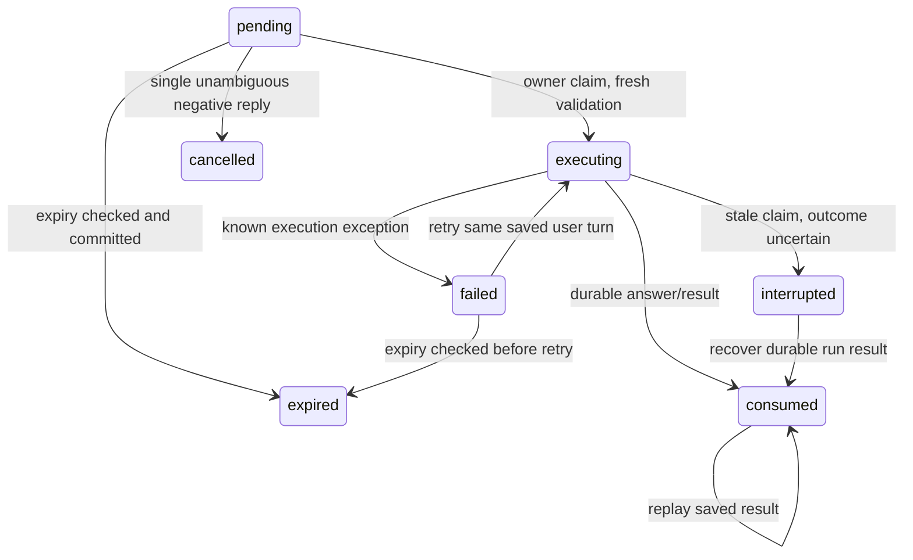

# SALS 0.3 Stabilization R1 — Follow-up Repair

Date: 2026-11-13. Scope: Spark in PwaniNet/Vasto. Overall: **IMPLEMENTED — UNVERIFIED** pending owner PostgreSQL and browser acceptance. No R2–R5 or WP4 work undertaken.

## Reproduced root causes

The starting service consumed before executing, returned success for continuation/clarification signals, called a nonexistent unit-learning concept accessor, lacked answer_followup execution, raised an undefined ValidationError on expiry, and executed cancelled short replies in the chat route. Replays returned 404, failure lost retryability, and cancellation did not recheck state under lock. Existing tests verified resolution rather than actual action completion. These findings were verified against the current files before edits.

## Files changed for R1

- `pwanimate/services/followups.py`: authoritative claim, validation, cancellation, expiry, durable execution, replay and interruption fencing.
- `pwanimate/followup_models.py`: persisted execution result, execution-run reference, claim timestamp and lifecycle choices.
- `pwanimate/migrations/0035_followup_execution.py`: additive schema migration; not applied to an owner database.
- `pwanimate/api/followups.py`: controlled HTTP responses and optional conversation binding.
- `pwanimate/api/views.py`: cancelled replies continue normal chat; accepted replies use repaired executor and return real response payload.
- `pwanimate/api/serializers.py`: restore executing/failed/interrupted offers as well as pending offers.
- `pwanimate/services/teaching.py`: preserve existing objective/mode/exercise for explicit follow-up continue/practice commands; omit topic suggestions without a concrete target. No mathematical-content changes.
- `static/js/pwanimate/pwanimate-chat.js`: conversation binding, in-progress refresh, retryable failures and stale-action disabling.
- `tests/sals_03_wp2/test_followups.py`: acceptance alone no longer asserts consumption.
- `tests/sals_03_wp2/test_followup_repair.py`, `tests/spark/followup-repair.cjs`: regression checks.
- `scripts/test-sals-r1-postgres.sh`: owner-run disposable verification entry point.

The workspace already contained extensive unrelated modifications and untracked SALS implementation. Those were retained; this inventory describes R1 edits, not the entire working-tree diff.

## Supported action inventory and execution semantics

All successful operations delegate to the existing `agent_execution.execute_claimed`, which persists answers and journals, and to the existing teaching runtime when appropriate. No second orchestration engine was added.

- **teaching_continue**: requires originating active session; advances the existing teaching phase/exercise without resetting mode/objective.
- **practice_problem**: requires that session; starts practice through the teaching command state machine, rather than only changing mode.
- **teaching_topic**: requires a concrete concept from `ConceptMasteryService.owned_concept`, matching the session learning record/unit/semester. Configures the target using the current mode, then executes the teaching turn. Missing target is rejected, not treated as a generic switch.
- **clarification**: initiates a clarification request with the originating answer in bounded conversation history. Actual Spark execution must persist a resulting answer or question before success.
- **answer_followup**: requires a nonempty question of at most 1,000 characters; executes that question with originating history.

Unsupported actions, unexpected payload keys, malformed arguments and mismatched contexts are rejected. The API accepts an ID, not executable client-supplied instructions. UUID of the follow-up is the idempotency key; arbitrary request IDs cannot authorize another execution.

## Lifecycle



Claims/cancellation serialize on the follow-up row. Locks are released before provider work. A concurrent click returns HTTP 202 with stable executing status; a successful replay returns HTTP 200 and saved response. Expired/cancelled requests return 410; mismatched context or an unrecoverable interrupted attempt returns 409; malformed input returns 400; missing/foreign IDs return 404; unexpected execution failures return 503 and preserve retryability. Expiry is committed before raising its controlled error. Negative replies include No, Not now, Skip and Maybe later; they cannot invoke execution. Ambiguous or multiple-offer replies remain ordinary chat.

## Idempotency, retry and process interruption

The claim transaction records the run and user message before generation. Failed retries retain the same run/message, allowing teaching receipt keys to prevent repeated transitions. A committed run result can finalize an offer even if the process died before recording consumption. A stale claim without a committed result becomes interrupted; it is deliberately not automatically re-executed because the prior provider attempt may still be running. Existing run recovery/status/journal infrastructure remains the recovery surface. This conservative fence prevents blind duplicate output; it does not promise seamless automatic recovery after every process failure.

## Durable continuity

An explicit server-persisted interaction_id can resume only that owned pending interaction on the originating waiting run. Teaching active_run must match. Completed runs are never resumed. Suggestions without an interaction binding represent a genuinely new user turn: a new durable run is recorded; its snapshot includes bounded history through the originating assistant message. A waiting/running/queued conversation task blocks an unbound new turn. The originating run pointer is preserved separately from execution_run.

Teaching continuation/practice use the existing state and checkpoint receipts. Topic switches preserve mode while deliberately changing target. Every action must yield a persisted message; action signals alone are failures. Click results use existing conversation reload; short replies return the existing chat response shape. Execution journals are available through existing run endpoints. The click endpoint is synchronous JSON; it does not introduce another SSE transport. Browser disconnect/reload can recover the durable result and existing journal.

## Security and learning integrity

Owner-scoped lookup is repeated at execution. Model validation binds message, conversation, student and originating run. Optional client conversation ID must match. Session must be active, owned, attached to that conversation and match the runtime's selected session. Fresh teaching authorization validates tracking revision, consent, enrollment activity, term eligibility and record ownership; topic concepts must belong to the same learning record. Authorization is rechecked before work, rather than relying on cached academic context. Expected validation failures do not consume actions. Clicking an action does not submit assessment answers or create independent mastery evidence.

## Local verification

Initial existing suite: 287 reported tests, OK with 19 skipped; Node teaching/lifecycle/math/question/composer/quiz contracts passed. This was followed by a final broader rerun after the repair changes; final results are appended below.

Focused R1 suite at the intermediate checkpoint: 16 reported tests, OK with one PostgreSQL concurrency skip (15 non-skipped). Includes real teaching phase advancement and receipt replay, all teaching action routing, owner/context/consent rejection, failure/retry, result replay, expiry persistence, cancellation and interruption fencing. Provider execution in lifecycle tests is mocked; the phase/receipt test executes the real teaching service. A PostgreSQL threaded duplicate-click/cancellation test is supplied but was not run here. Later API additions and final results are appended below.

`node tests/spark/followup-repair.cjs` passed: executes the actual extracted click-handler body with mocked fetch/DOM, covering duplicate suppression, result reload, in-progress response, failure/network retry and expiry. This is not real-browser verification. JavaScript syntax and Bash syntax checks were run. Existing isolated settings emit Axes middleware/backend warnings.

A migration-drift check under SQLite sync-schema settings was unsuccessful because those settings disable migration modules; this is not a passed migration check. An earlier default-settings dry-run attempted a migration-history connection and logged a connection warning; no migrations or data writes were performed. Migration application/rollback remains owner verification.

## Owner PostgreSQL commands

Ubuntu Bash, from the project checkout, with the project's virtualenv and Docker dependencies available:

```bash
cd /home/zayne/projects/pwaninet
SALS_TEST_PYTHON=.venv/bin/python bash scripts/test-sals-r1-postgres.sh
SALS_TEST_PYTHON=.venv/bin/python bash scripts/test-sals03-wp2-postgres.sh schema
```

These use the existing disposable runner, which provisions a random container and isolated credentials, strips inherited DB configuration and removes its disposable resources. It does not accept an owner database URL. No Docker or PostgreSQL test command was executed during R1. Verify migration 0035 on the disposable graph, threaded double-click/cancel behavior, constraints and original-run ownership before deployment.

## Browser acceptance checklist — IMPLEMENTED — UNVERIFIED

- Trigger a useful teaching suggestion automatically; click and observe a real persisted answer in the same conversation.
- Exercise each action and topic target; continue/practice retain the intended teaching state and mode.
- Double-click and repeat from another tab: one user message, response and checkpoint sequence.
- Reply yes with one offer; reply No / Not now / Skip / Maybe later; old cancelled button cannot execute.
- Multiple offers and ambiguous replies do not silently execute.
- Force provider failure, retry, reload while executing and reconnect after result commit; verify correct message and offer states.
- Expire an offer: controlled stale response, disabled stale control, no execution.
- Revoke tracking or change enrollment/semester before acceptance: reject academic execution.
- Confirm waiting interactions resume their owning run; unbound offers cannot steal that run; completed origin remains completed.
- Check mobile safe areas and both existing themes. Existing components/styles are reused.

## Remaining limitations and revised stabilization checklist

- R1 local lifecycle/service and frontend-handler regressions: VERIFIED within the executed scopes below.
- R1 PostgreSQL locking, migration application and transactional races: IMPLEMENTED — UNVERIFIED.
- R1 actual browser, mobile/theme, SSE reconnect and live-provider outcomes: IMPLEMENTED — UNVERIFIED.
- Automatic replay of uncertain interrupted work: NOT IMPLEMENTED by design; uncertain attempts are fenced and durable results are recoverable. Owner should verify existing runtime recovery behavior for this case.
- Full browser short-reply/reconnect coverage and exhaustive semester/enrollment race coverage: PARTIAL; acceptance remains necessary.
- R2–R5 and WP4: NOT IMPLEMENTED by this package; no work begun.

R1 must not be marked fully verified until owner PostgreSQL and browser acceptance are complete.

### Final executed results

- Broader local script: **303 tests reported, OK, 20 skipped**, 84.301 seconds; 283 non-skipped cases. Existing six Node contract groups, JavaScript syntax and PostgreSQL-script shell syntax passed. This run included the first 16 R1 cases.
- Expanded focused R1 suite: **29 tests reported, OK, one skipped**, 2.252 seconds on the final rerun after validation-error mapping. 28 non-skipped cases; API subclass deliberately reruns base lifecycle cases as well as adding API ownership/completed-run checks. These totals overlap and must not be added as unique coverage.
- New actual-handler Node regression: PASS. Final JavaScript syntax, Bash syntax and tracked-file whitespace checks: PASS.
- PostgreSQL concurrency test: SKIPPED locally. Browser acceptance: NOT EXECUTED. Live providers: NOT EXECUTED. Owner migration application: NOT EXECUTED.

No owner database migration, Docker command or PostgreSQL test suite was run. R1 is locally tested and documented; owner acceptance remains outstanding. No later stabilization package was begun.
