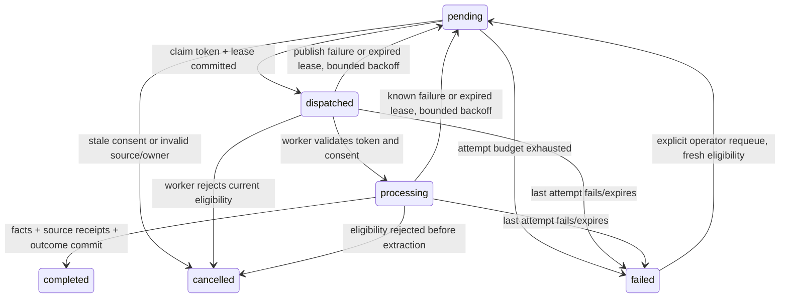

# SALS 0.3 Stabilization R2 — Durable Memory Dispatch

Date: 2026-11-14. Application: PwaniNet/Vasto Spark. Overall status: **IMPLEMENTED — UNVERIFIED** pending owner PostgreSQL and operational acceptance. R2 changes delivery, not memory extraction semantics. No R3–R5, WP4, UI, mathematical teaching or retrieval work was undertaken.

## Root cause and architecture

Previously, `ConversationService.persist_assistant_message` committed an assistant message, then ran `queue_extraction` from an on-commit callback. That callback published `extract_memories` directly to Celery. Broker failure was logged without recording pending work. A process dying after commit but before callback, or an unavailable broker, permanently lost the scheduling intent. Late acknowledgements/retries only protected tasks already received by a worker.

Now, the assistant message and a `SparkMemoryDispatch` row commit in the same transaction. Scheduling does no broker/model work. An on-commit callback starts a bounded best-effort dispatcher thread; durable recovery does not depend on that callback or thread surviving. Celery beat finds indexed due rows every minute. The worker uses the existing `PersistentMemoryService.extract`; facts, original source receipts and completion commit together.

The inspected production assistant-write path is the existing ConversationService; its normal callers, including durable run execution, inherit atomic scheduling. Direct ORM writes used by tests are not automatically intercepted. There is no per-chat historical scan or new memory source. This closes the atomicity gap for the supported writer. Earlier messages lost before this rollout are not bulk-backfilled; old broker deliveries can enter the new scheduler only while their original revision remains eligible.

## Files changed

- `pwanimate/memory_dispatch_models.py`, re-export in `pwanimate/models.py`: additive delivery model.
- `pwanimate/migrations/0036_memory_dispatch_outbox.py`: generated additive migration after R1's 0035, with no data migration.
- `pwanimate/services/memory_dispatch.py`: scheduling, eligibility, claims, leases, dispatch, processing, backoff and bounded recovery.
- `pwanimate/services/conversation.py`: durable intent inside the existing message transaction.
- `pwanimate/services/persistent_memory.py`: queue wrapper delegates to durable scheduling; extractor/retrieval algorithms unchanged.
- `pwanimate/tasks/conversation_memory.py`, task package exports: delivery processor, periodic recovery and backward-compatible legacy task ingress.
- `pwaninet/settings/base.py`: minute-based Celery beat entry on docs_queue.
- `pwanimate/management/commands/spark_memory_dispatch.py`: inspection, bounded recovery and explicit failed-row requeue.
- `tests/spark_memory/test_dispatch.py`: failure, lifecycle, migration, operations, performance and owner-run concurrency checks.
- `tests/spark_memory/test_pipeline.py`: previous direct-publish expectations updated to assert durable behavior.
- `scripts/test-sals-r2-postgres.sh`: owner-only disposable PostgreSQL verification script.

Pre-existing uncommitted/untracked SALS work remains in this workspace. This list identifies R2 edits rather than claiming the full working-tree diff belongs to R2.

## Data model

Each delivery row stores owner, assistant message/conversation FKs, immutable source identifiers, consent revision, eligibility policy version, status, attempts, next-attempt time, claim token, lease deadline, terminal timestamp and a short error class/reason. It stores no raw transcript or extracted facts. Nullable SET_NULL source FKs allow deletion to be detected and cancelled while retaining delivery metadata; owner deletion cascades. The stable key is unique `(source_message_id, consent_revision)`.

Indexes cover `(status, next_attempt_at)` and `(status, lease_until)`. Recovery inspects at most 50 rows by default, hard-capped at 200. There are no destructive transformations of existing facts, consent or receipts.

## Lifecycle and transaction boundaries



`dispatched` means a publish attempt is durably armed, not proof of broker acknowledgement. This combines CLAIMED/DISPATCHED and avoids an unnecessary extra state. `updated_at` and lease deadline record claim timing. Pending with attempts > 0 is retrying, not a separate status.

1. Message transaction: insert final assistant message, check preference, get/create outbox row, register optional wake callback, commit. Failure to persist intent rolls the message back; it is not swallowed as an optional scheduling error.
2. Dispatcher transaction: lock one job, revalidate ownership/consent, increment attempts, assign random token and five-minute lease, commit. Publish occurs outside all row locks.
3. Worker claim: lock one row, validate token/status/lease, take consent lock, verify source ownership, set processing, commit.
4. Extraction transaction: re-lock and fence job, lock current consent plus source message/conversation, invoke the existing local deterministic extractor, commit its receipts/facts and job completion together. There is no provider call in the current extractor and no row lock spans broker or model/provider I/O. If future extraction adds remote inference, it must split inference from this locked write transaction.

The preference lock is shared with revocation, reset and memory deletion. Concurrent revocation either commits first (worker cancels) or waits for the authorized extraction transaction, then applies afterward. A worker cannot commit new facts after a prior revocation has committed using an obsolete preference snapshot. Source/conversation row locks prevent ownership reassignment or deletion from racing the final write checks.

## Retry, idempotency and interruption recovery

Dispatch/processing failures and stale leases use exponential backoff: 15 seconds × 2^(attempt−1), capped at 3,600 seconds, with 0.8–1.2 jitter. Maximum eight automatic publish attempts. Terminal failed rows remain visible; only an explicit operator command starts a fresh bounded attempt budget after checking current eligibility. Delayed old tasks cannot steal a new attempt: both phase and token must match.

If the broker accepted work but acknowledgement is lost, the dispatcher only changes a row still in its dispatched/token state. A processing/completed worker outcome is preserved. If accepted work has not claimed yet and publication is marked failed, a later delivery is fenced out; the due durable row will be republished. A dispatcher dying after claim leaves a recoverable lease. A worker dying before extraction leaves dispatched/processing state for lease recovery. A worker dying during extraction rolls back facts/receipts/completion together. A worker dying after commit but before Celery ack produces a harmless duplicate delivery.

The existing extractor serializes on the owner's preference, deduplicates per-source receipts, guards approved/proposed owner corrections and rejected/revoked topics, and applies deletion cutoffs. Retries neither invent another approval flow nor generate permanent duplicate facts. No successful-task response or Celery result backend is needed to discover completion.

## Consent and ownership safety

Scheduling, dispatch and processing require current supported consent version, enabled memory, enabled automatic extraction, matching revision, automatic enable timestamp and applicable reset boundary. Every processing attempt checks the expected message role/task, original identifiers, conversation and user. Expired consent cannot be revived by a new grant; earlier requests keep their original revision and must be cancelled. Outbox metadata contains no cached academic/personal facts. Existing extraction-type rules, source cutoffs, deletion and rejection safeguards remain authoritative. The outbox does not modify academic tracking, concept mastery, teaching, memory quality or relevance ranking.

## Recovery scheduling and operations

Celery beat publishes `pwanimate.tasks.conversation_memory.recover_memory_dispatch` every 60 seconds to docs_queue. Workers consuming docs_queue process delivery tasks with late acknowledgement and worker-loss rejection. Application-level retry state lives in the DB, not Celery retry counters. A database/schema outage stops that sweep with an explicit logged database-unavailable result; no extraction is attempted. Next beat can retry after migration/database recovery. Import/startup does not scan tables. Restart recovery depends on running beat/workers or the explicit management recovery command.

Immediate wake uses at most two background dispatcher threads per application process. Saturation or process loss simply leaves due rows for scheduled recovery. Neither broker timeouts nor extraction execute synchronously in chat. The semaphore limits the optional accelerator only; it is not a correctness lock. All correctness claims are database-backed.

Structured key/value logs include job ID, attempt, terminal/retry status, reason and stored count. Sweep returns inspected outcome counts. Inspection includes counts and bounded outstanding rows with attempts and deadlines. No dedicated external metrics exporter/dashboard was added; logs and DB counts are the supplied operational signals.

Read-only inspection on a migrated environment:

```bash
cd /home/zayne/projects/pwaninet
.venv/bin/python manage.py spark_memory_dispatch --limit 50
```

Explicit operational actions, only after reviewing the target environment:

```bash
.venv/bin/python manage.py spark_memory_dispatch --recover --limit 50
.venv/bin/python manage.py spark_memory_dispatch --retry-failed UUID
```

The second command refuses obsolete consent. These operational commands were not executed against owner data during development. Monitor failed counts, oldest pending age and expired leases. If Celery beat or docs_queue consumers are absent, rows remain safe but delivery will be delayed. No automatic terminal-row purge is supplied, preserving idempotency history.

## Rollout and rollback

Apply additive migration 0036 before enabling the new writer/workers; preserve original memory tables. Do not deploy the new atomic writer against an unmigrated schema: it intentionally refuses a message commit without durable scheduling. Deploy compatible workers and beat configuration together; restart workers to register new tasks. Old task names remain supported, and previously queued old deliveries are revision-validated.

Rollback application code with the additive table retained is the safest code rollback. Drain or export pending metadata before reversing schema; dropping the outbox loses outstanding scheduling intent even though existing facts/receipts remain intact. Keep processing disabled while removing schema. No migration was applied to an owner database here.

## Verification and performance

Local SQLite checks exercise the real delivery model, preference/receipt/fact writes, failure rollback and real additive migration operation. Broker exceptions, ambiguous acknowledgements and extractor timeouts are mocked. The current extractor makes no provider calls; timeout injection represents a transient extraction failure, not a measured provider failure.

Intermediate focused run: 21 tests reported, OK with two PostgreSQL skips (19 non-skipped). Actual 0036 application on an isolated pre-outbox table state preserved an existing approved memory. Migration drift check using the real graph and isolated SQLite settings: `No changes detected`. No owner DB settings were loaded for migration generation/checking.

Local scheduling benchmark in that run, 20 samples each:

- Existing/idempotent request: mean 7.930 ms; maximum 15.774 ms.
- New outbox request: mean 10.208 ms; maximum 15.980 ms.

These include local ORM scheduling only; new-message insertion, broker, provider, network, streaming and production DB contention are excluded. They are not production latency claims. Disabled users avoid insertion, source-history scans and wake threads. Final suite outcomes and final measurements are recorded below.

## Owner disposable PostgreSQL verification

Ubuntu Bash, project checkout, virtualenv plus existing Docker/pgvector prerequisites:

```bash
cd /home/zayne/projects/pwaninet
SALS_TEST_PYTHON=.venv/bin/python bash scripts/test-sals-r2-postgres.sh
```

The existing WP0 runner provisions a fresh randomly named disposable container/DB with isolated credentials, strips inherited owner DB configuration and cleans up resources. It does not accept an owner database URL. This script runs memory, academic units, mastery and teaching/R1 compatibility suites, including R2 migration/unique-constraint checks and PostgreSQL-only threaded claim/revocation checks. No Docker command or PostgreSQL test suite was executed here.

## Outstanding acceptance and status checklist

- Atomic assistant/outbox commit, duplicate scheduling, controlled retry and dead-letter visibility: VERIFIED locally; PostgreSQL behavior IMPLEMENTED — UNVERIFIED.
- Consent/revision/reset, ownership, deletion/rejection and real extractor receipt/fact compatibility: VERIFIED within local covered cases; concurrent PostgreSQL acceptance IMPLEMENTED — UNVERIFIED.
- Duplicate/stale delivery fencing and transactional fact/outcome rollback: VERIFIED with isolated DB and mocked broker/task failure; real SIGKILL/network partitions IMPLEMENTED — UNVERIFIED.
- Actual additive migration operation and real-graph drift check: VERIFIED locally; PostgreSQL migration application/rollback IMPLEMENTED — UNVERIFIED.
- Periodic recovery task registration, bounded batches, inspection and operator requeue: implemented and locally exercised; live Celery beat/routing/restart integration IMPLEMENTED — UNVERIFIED.
- Production latency and saturation/large-queue profiling: NOT IMPLEMENTED as measurements; local scheduling measurements only.
- Dedicated monitoring exporter, retention automation and historical lost-job backfill: NOT IMPLEMENTED; neither is needed for the new atomic path, but operations must monitor backlog.
- Full infrastructure-failure acceptance: PARTIAL until the owner tests broker outages/timeouts, accepted-but-unacknowledged publish, dispatcher/worker termination before and after commit, database outage, restart and stale leases with real processes.
- R1 owner PostgreSQL/browser gates remain outstanding; R2 does not claim to close them.
- R3, R4, R5, WP4: NOT IMPLEMENTED by this package; no work begun.

Do not mark R2 production reliability VERIFIED based on mocked local failures. Stop at owner review and operational acceptance.

## Final executed results

- Broad permitted regression command: `bash scripts/test-sals03-wp2-local.sh` — **337 tests reported, OK with 22 skipped**, 136.554 seconds; 315 non-skipped cases. Existing teaching/lifecycle/math/question/composer/quiz Node contract groups passed. This run includes the R2 tests present at its start, R1 and existing SALS service suites.
- Final focused command: `SPARK_MEMORY_SYNC_SCHEMA=1 DJANGO_SETTINGS_MODULE=tests.spark_memory.settings .venv/bin/python manage.py test tests.spark_memory.test_dispatch --noinput` — **41 reported, OK with two skipped**, 7.268 seconds; 39 non-skipped cases. Operations subclass repeats the inherited base scenarios; these are not 39 unique failure scenarios. The skipped tests are PostgreSQL-only dispatch-claim and consent-revocation races.
- Separate operator inspection/requeue checks: two tests, OK. Final actual-handler R1 Node regression: PASS. Bash syntax and tracked-file whitespace checks: PASS.
- Real-graph migration drift check, with isolated SQLite settings and migrations enabled: **No changes detected**. Generated migration 0036 and the isolated real-operation migration test passed; neither applies migrations to an owner DB.
- Final focused measurements (20 samples per batch; base cases run twice through inheritance): existing schedule mean 4.496/6.507 ms, max 12.432/13.628 ms; new schedule mean 8.886/9.003 ms, max 11.871/13.981 ms. These exclude optional post-commit thread startup and broker/provider work. They overlap other test runs and are not independent production benchmarks.
- Mock broker/transient extraction failures produced expected retry logs. Isolated settings emitted existing Axes middleware/backend warnings; negative API cases and a missing mock model registry entry also produced expected logs without suite failure.

All totals overlap; do not sum them as unique tests. No Docker, PostgreSQL suite, production infrastructure failure injection or owner database migration was executed. R2 implementation and permitted local verification are complete; production reliability remains **IMPLEMENTED — UNVERIFIED** until owner acceptance. No later stabilization package was begun.
