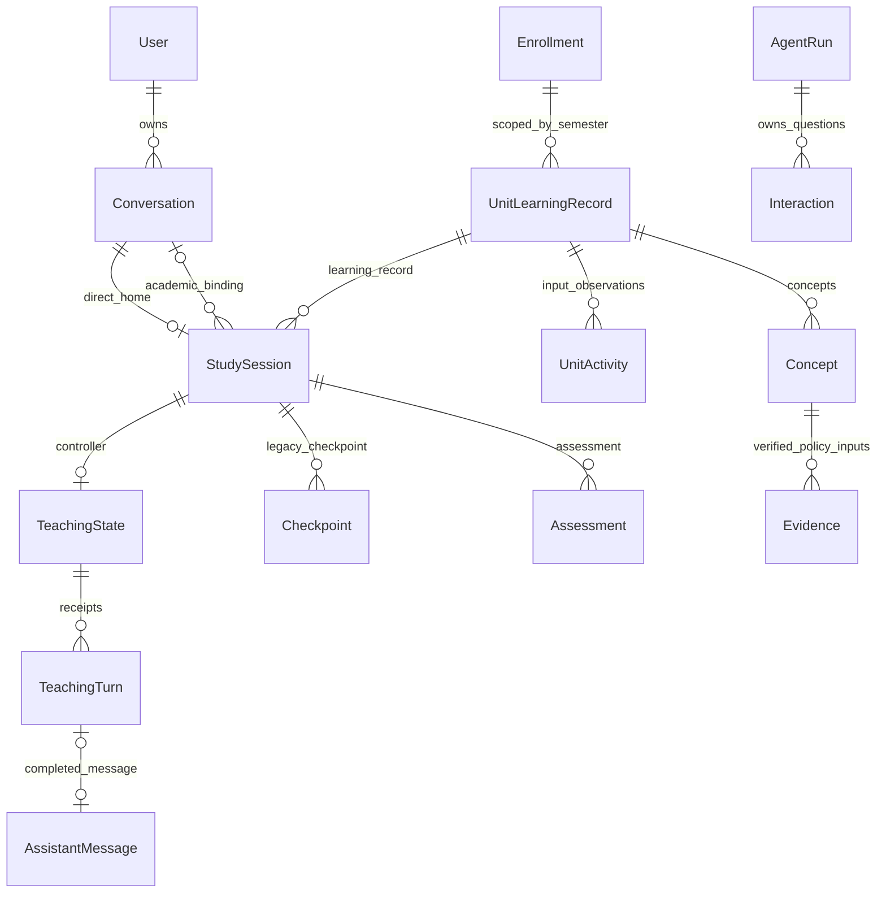
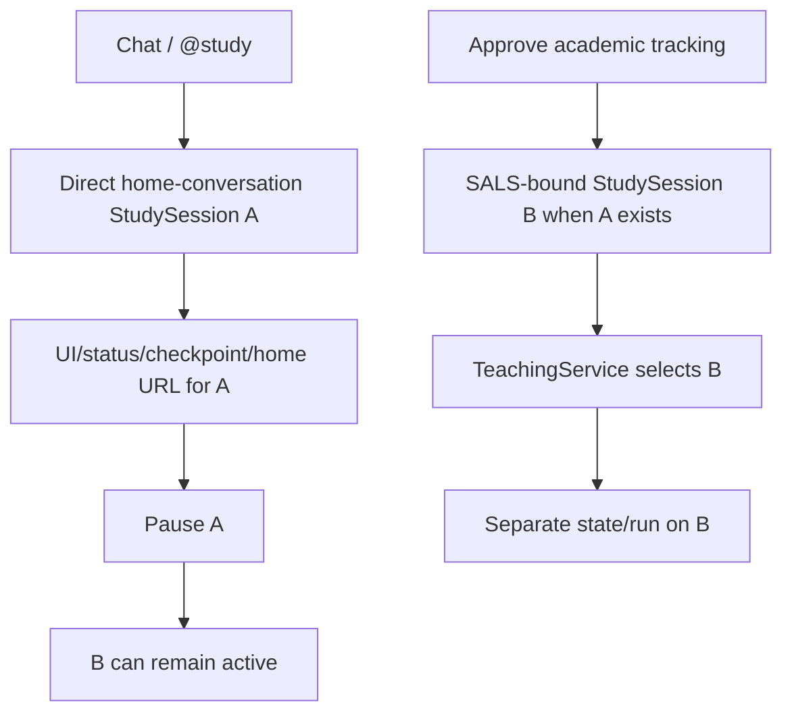
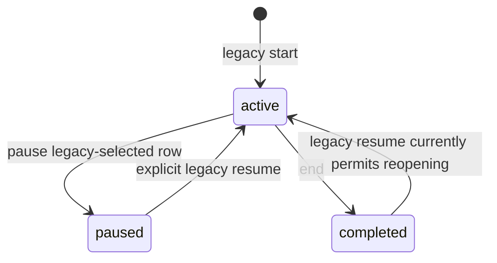
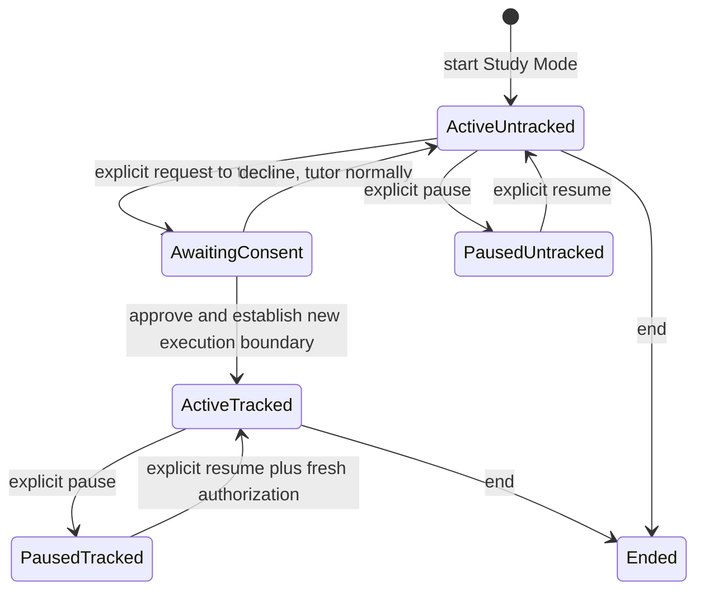
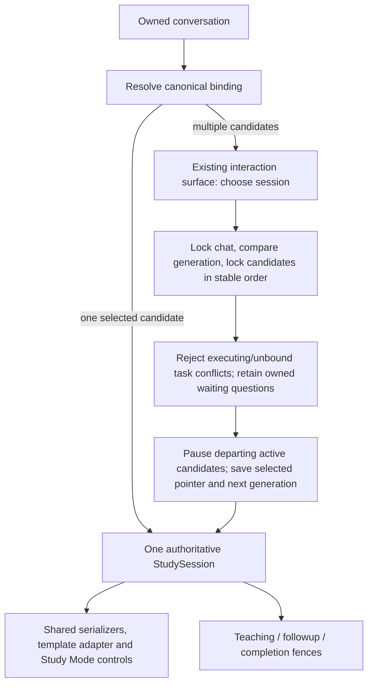

# WP4 — Unified Study Mode Architecture

Date: 2026-11-14. **Coordinated implementation completed under subsequent owner authorization; PostgreSQL and browser acceptance pending.** Sections 1–9 preserve the pre-implementation audit/design; section 10 records the implemented architecture. No real student data was changed.

## 1. Existing-system inventory

### Study Mode

`services/study_session.py::parse_study_command` recognizes a leading @study and separates its remaining query. `api/views.py::PwanimateChatView._post_chat` supports bare activation without an AI request and activation with tutoring content. It also activates from study_mode, study_session_id or an existing active session.

`PwanimateStudySession` is the actual persistent session: owned by a user, one-to-one with its home conversation, status active/paused/completed, unit/unit_scope, objective/topic, context resources, roadmap, progress percentages, latest checkpoint and lifecycle timestamps. A session is not a consent grant or a mastery verdict. Its legacy unit scope is not inherently an enrollment+semester identity.

`StudySessionService` owns start_or_continue_session, pause_session, resume_session, end_session, resource restoration, bounded history, checkpoint generation, summaries and serialization. Pause preserves data. Resume can reopen a completed session and pauses peers sharing unit_scope. The home conversation is used for history, URLs and restoration. get_session_for_conversation resolves only that direct home relationship.

`build_study_orchestration_context` assembles checkpoint, bounded recent/older dialogue and document availability warnings. The orchestrator injects this independently of SALS authorization. StudySessionService-generated summaries and legacy percentage/roadmap state must not be recast as WP1 mastery.

### SALS

- `documents/academic/models.py` and related academic models supply enrollment, academic unit, academic year and semester. UnitLearningService rechecks current eligibility and isolation rather than manufacturing curriculum enrollments.
- `SparkAcademicTrackingPreference`: ask/automatic/disabled, consent revision and change boundary.
- `SparkUnitLearningRecord`: owner/enrollment/unit/semester identity, authorization timestamp/revision/conversation.
- `SparkUnitActivity`: consented source-message observations; does not certify completed teaching.
- `UnitLearningService.approve_action/_session`: validates an existing PendingAction, authorizes future source activity and creates/reuses a session. If a direct conversation session exists, Phase B can create a different home conversation/session and bind it with academic_conversation.
- `SparkTeachingState`: session-owned controller phase, mode, concept, exercise and active run. `SparkTeachingTurn`: stable receipt, interactions/evaluation, response and finalization provenance.
- `TeachingService`: chooses direct or academic-bound sessions; validates tracking and attribution; transitions state and creates durable questions. Preparation is not completion.
- `academic_progress.py`: completion linked atomically to an assistant message; joins finalized teaching history; ordinary answers become exposure only with unambiguous authorized source provenance. The PostgreSQL self-row locking hotfix is preserved.
- WP1 `concept_mastery.py` and assessment services: independent verified evidence, provenance, prerequisite/retention policy and recalculation. Exposure and legacy progress percentages cannot grant mastery.
- R1 followups use owned persisted offers, execution results and existing run continuation. R2 memory dispatch is a separate personal-memory delivery outbox, not academic evidence.
- Migration 0037 adds nullable academic conversation binding and teaching completion provenance; no historical turn is automatically completed.

### Orchestration and documents

`PwanimateOrchestrator.run` tests TeachingService before ordinary routing, then uses existing deterministic/tool, routine-tutoring and RAG paths. `StudyAgent.run` also delegates to TeachingService for a persisted teaching state or applicable teaching request. The durable agent executor refreshes context and persists the answer/completion through ConversationService.

`DocumentTurnContext` resolves authorized document identity and page intent. `retrieval/services/document_retrieval.py` retrieves indexed chunks and reads actual document academic-unit associations, using enrolled/programme relevance tiers. `documents.access_policy` remains authoritative for document access. Open resource descriptors are not permission or proof of enrollment; multi-unit documents cannot select an academic session by guesswork.

Successful textbook RAG does not imply a teaching turn: attachments explicitly bypass TeachingService.applies, topic-free follow-ups can fail its attribution gate, a session can be untracked, and ordinary completion requires an authorized attributed source activity. A document being opened/retrieved is not a completed lesson. The previous live diagnosis confirmed a pre-consent request followed by an unattributed cutoff complaint; it did not prove that every explicit post-consent lesson fails.

### UI and API surfaces

- `static/js/pwanimate/pwanimate-chat.js`: @study chat state, active studySessionId, document-context restoration, existing session header/actions, early academic consent cards, unified question composer and activity/SSE integration.
- `static/js/spark-study-sessions.js`: desktop session modal/mobile settings-style session surface; unit/status/topic, pause/resume/end, assessments and reports.
- `static/js/spark-study-desk.js`, `spark-unit-learning.js`: academic/memory/unit surfaces with separate service data.
- `templates/pwanimate/partials/chat_content.html`, conversation-list templates and `pwanimate/views.py`: direct study_session relation and initial serialized active/resumable session.
- `api/urls.py`: existing study-sessions detail/status/checkpoint/summary/assessment/report, teaching, academic record and action endpoints.
- Existing document viewer, theme tokens and safe-area styling must stay intact. No second navigation or new composer is proposed.

## 2. Current relationship map



The same model stores both legacy and SALS sessions; the conflict is different selectors and lifecycle scopes, not a lack of another session table.

## 3. Current lifecycles and architectural conflict





SALS `_session` separately searches active bound rows. A paused bound row is not returned by that search; a new active row can be created instead. For legacy scope the active uniqueness key is user/unit_scope; SALS uses a record-and-conversation-specific scope. These are different policies despite sharing the status field.

### Reproduced conflicts

Two isolated SQLite integration checks executed actual existing factories/services:

1. Create a legacy session in a conversation, request an enrolled topic and confirm tracking. The UI selector returns legacy A; TeachingService returns bound SALS B. Pause the UI-selected A: B remains active.
2. Pause an academic session and call the academic session resolver for that conversation. It returns a different newly active controller while the original remains paused.

Both checks passed because they asserted these **existing defects**, not because unification succeeded. The authority conflict is also present in API validation: `_post_chat` requires study_session_id.home_conversation == conversation_id, while TeachingService can accept academic_conversation. Serialization and navigation emit the home URL; teaching may execute in the bound chat. Changing one selector would leave another path inconsistent or redirect to a different conversation.

A destructive one-to-many replacement of conversation.study_session would affect reverse select_related calls, serializers, templates, views and restoration. It is not the recommended solution. Nor is blindly copying status between A and B: that could pause a live unrelated question, mutate a legacy session without explicit handoff, or revive an old run.

**Decision:** stop before application changes. The mission explicitly requires stopping when substantial architectural conflicts demand cross-cutting changes. A canonical active-binding/handoff contract must precede coordinated lifecycle, chat validation, serialization, restoration and consent-execution changes. This is more than a safe isolated route adjustment.

## 4. Proposed authoritative architecture

Retain PwanimateStudySession as the single lifecycle authority. Study Mode supplies UX; SALS supplies validated academic identity and evidence; the existing orchestrator executes; existing document services supply sources.

Introduce a compatibility adapter returning a server-authoritative `ResolvedStudyContext`:

- owner, active chat and canonical session ID;
- session lifecycle status and revision/generation;
- optional validated record/enrollment/unit/semester;
- recording posture: untracked, needs approval, authorized, revoked/read-only or ambiguous;
- authorized document resources/page targets;
- exact pending interaction/run or explicit no-run state;
- retained progress reference, without upgrading observations to mastery.

This is a proposed contract, not a new orchestration engine or implemented DTO. Every reader/writer must use it: chat selection, direct views, serializers, session status endpoints, TeachingService, followups and restoration. The old home relation remains a compatibility view, not an independent active-session selector.

### Canonical binding and handoff

Fresh Study Mode starts have one untracked session. Explicit tracking may attach the valid academic identity to that same session **only after an explicit authorization boundary**, exact owner/unit/term checks and confirmation that doing so cannot relabel historical outcomes. Existing legacy history remains untracked. If attachment is incompatible, use a validated binding and explicit handoff, not a second silently active controller.

For existing A/B collisions, the adapter must return an ambiguity/handoff state until the user chooses the session to continue. The handoff transaction locks the chat binding and affected sessions in stable order, compares the presented binding generation and atomically updates the active pointer/status. It must not move/delete/rewrite old sessions, transfer old mastery or resolve a pending interaction as a side effect. If an interaction is pending on the departing session, the UI must explicitly retain it paused or settle it through its own owning run. Do not silently choose newest/oldest.

### Target lifecycle



These diagram nodes combine lifecycle and recording posture; do not implement all as new database status values. Existing active/paused/completed remain lifecycle state. Completion should require an explicit new-session decision rather than legacy resume silently reopening completed state. A history read does not activate any session.

## 5. Consent and first tracked execution

Start != track. The existing PendingAction must remain the actual authorization decision. Unlike Phase B's nonblocking first lesson, a first **tracked** lesson must wait on the existing durable run's approval interaction. Decline resumes that requested tutoring task untracked; approval creates a post-approval execution/input receipt linked to the decision, then runs it. Do not rewrite the timestamp of the pre-approval message or retrospectively complete old content.

The new preflight can classify units/documents deterministically; no extra LLM call is needed. The action endpoint, run decision/claim endpoint and frontend must share the same decision lifecycle. Confirming an action without resuming its waiting run is not completion. Do not reuse an unrelated waiting question to obtain consent. Keep ask/automatic policies, revision checks, fresh write authorization and R1 replay guarantees intact.

## 6. Teaching, capture, retrieval and continuity

- Feed the same ResolvedStudyContext to Study Mode prompting and TeachingService. Do not infer the active controller from two independent queries.
- Resolve a document's actual unit association through existing ACL/enrollment metadata. A uniquely matching eligible unit can support attribution; conflicting/absent mapping requires clarification. Preserve chunk/document version/page citations when present; never invent page numbers.
- Pass document context into the existing controller/generation/retrieval path. Keep literal textbook content separate from controller-authored practice; do not simply remove the attachment bypass without verifying grounding.
- Reuse teaching turns and completed_message/completed_at. Persist finalized explanations, assignments and attempts incrementally; known partial content remains incomplete. Retrieval/opening alone creates no exposure or evidence.
- WP1 remains the only mastery authority. Legacy progress/mastery percentages need explicit distinct labels until projected from validated evidence.
- Pause preserves completed turns and exact pending interaction IDs. Session-active checks fence continuation while paused; any in-flight result requires a defined finalization policy. Resume must not automatically claim another session's run.
- Cross-conversation history uses existing unit summaries/context injection with a validated read posture. “Return to session” must choose its canonical session and outstanding owned question explicitly. “Continue here” is a new execution boundary, never a false resurrection of another conversation's run. Multiple candidates produce clarification.

## 7. UI/API compatibility plan

Reuse session header/modal/mobile sheet, unit selection, consent block, unified composer, Spark Thinking and viewer. Replace data sources through the adapter, not by adding another navigation surface.

The session API should return canonical session, active chat, home chat, lifecycle, academic posture and pending practice distinctly. Existing study_session_id validation and serialization must understand the selected binding. A pause button must address the canonical displayed ID and return the authoritative resulting status; reload and SSE restoration must use that same generation/identity. No optimistic “active” UI state may authorize recording.

Current direct-relation templates/views require compatibility output from the adapter. Updating only the chat JavaScript or TeachingService would not unify pause/resume, document state or recovery.

## 8. Migration and rollout strategy

Do not alter the legacy one-to-one relation or backfill consent. First evaluate whether existing academic_conversation plus an explicit canonical pointer/generation is sufficient. If multiple preserved candidates require a durable selection, add a nullable per-chat canonical-session binding with owner validation and a unique active choice; keep a generation for concurrency. No destructive conversion or automatic candidate selection.

Roll out adapter reads and controlled writer routing together, with conflict detection for existing A/B rows. Migrate empty binding metadata only, never historical learning events. Keep R1/R2 schemas and semantics unchanged. Rollback must retain binding/decision receipts rather than discarding pending handoffs. Actual schema is not selected or migrated in this audit.

## 9. Acceptance gates and remaining decisions

The canonical handoff policy, pending-run suspension/finalization policy, first tracked execution boundary and legacy percentage semantics must be explicit before coordinated implementation. The owner must approve this design or a revised design before the cross-cutting compatibility change. Do not treat this architecture as WP4 implementation acceptance.

Required tests include all mission scenarios plus: A/B collision, pause through every UI/API path, stale binding-generation writes, completed-session reopening, concurrent handoff/consent/finalization, exact question restoration, foreign-document/unit mismatch, absent/ambiguous document associations and known interrupted provider responses. PostgreSQL and real-browser execution are mandatory release gates.

## 10. Approved coordinated implementation — 2026-11-14

**This section supersedes the earlier audit stop/design-only status.** The owner explicitly authorized coordinated backend/API/runtime/frontend implementation. The earlier inventory, conflict reproduction and baseline diagrams remain architectural history, not the current implementation status.

### Implemented authority

`services/study_context.py::ResolvedStudyContext` and `resolve` are the shared compatibility adapter. PwanimateStudySession remains the sole session/lifecycle model. Migration **0038_canonical_study_binding** adds only nullable `PwanimateConversation.canonical_study_session` and `study_binding_generation` (default zero). It preserves the home one-to-one relationship and migration 0037's academic binding/completion provenance.

Resolution checks the authenticated owner and accepts only sessions directly homed in or academically bound to that chat. A persisted canonical pointer wins only if it is still a valid candidate. One candidate can be inferred without writing; multiple unselected candidates return ambiguity. Read-only resolution never starts/resumes/replaces a paused session. Candidate metadata includes unit, status, topic and start time for explicit choice.

The adapter exposes canonical identity/generation, recording posture, enrollment/unit/semester, authorized document diagnostics, current resources, pending run/question, checkpoint and retained last finalized progress/mastery summary. Read retained history and write authorization remain distinct; disabled tracking suppresses model-oriented progress recall as in Phase B.

### Implemented handoff and lifecycle



`select` rejects stale generations and foreign/unbound candidates. It refuses handoff while an executing controller or unscoped task could be orphaned; owned waiting teaching questions remain on their original paused session. Selection does not implicitly resume a paused target or reopen a completed target. Legacy rows/history are neither merged nor copied.

Existing start/status/restoration/serialization readers route through the canonical adapter. Start will not create a replacement for a selected paused session; explicit resume is required. Completed-session resume is rejected. Pause/resume/end require the selected session and use conversation-first locking. Teaching preparation, answer claims, background execution and completion also fence against lifecycle/selection. A provider response already in flight may persist as dialogue after pause, but cannot finalize new academic progress for that paused session.

The direct template relation remains intact in the database. Server templates receive a resolved compatibility attribute; API serialization distinguishes active/bound conversation and original home conversation. Existing session header, modal/mobile surface, composer, activity trail and document viewer are reused. Existing A/B collisions require selection rather than arbitrary newest/oldest resolution.

### Implemented tracked execution boundary

```mermaid
sequenceDiagram
    participant U as Student
    participant C as Chat preflight
    participant R as Existing approval run
    participant T as Teaching runtime
    U->>C: Academic request / selected academic document
    C->>R: Persist PendingAction and pause requested run
    C-->>U: Start Tracking / Not Now, before lesson generation
    U->>R: Owned decision
    R->>R: Commit decision; persist one post-decision execution receipt
    R->>T: Continue original run with execution_boundary_id
    T->>T: Fresh scope/consent and canonical checks
    T-->>U: Explanation and owned practice interaction
    T->>T: Persist assistant and completion provenance atomically
```

Starting Study Mode remains untracked. On explicit tracking approval, a compatible current untracked session may acquire the academic record prospectively; this is an authorized attachment, not silent historical conversion. A mismatched existing unit/record requires another session/conversation. Historical rows are not relabelled as completed learning.

The original requested run remains the original run. An internal `academic_execution` source receipt is created once after decision and stored as execution_boundary_id in its durable snapshot. Teaching-turn provenance uses that receipt while original-run pause/resume still keys on the original request. Internal execution/authorization receipts are excluded from visible conversation/history so retries do not duplicate user questions. Decline runs ordinary untracked tutoring. First tracked execution makes no model call until the decision is resolved.

Ask/automatic/disabled policies remain intact. A retained session whose ask-scope/revision needs renewal can request a fresh PendingAction from the existing session surface without consuming its pending practice question; explicit approval renews future authorization and leaves paused state/question identity unchanged.

### Implemented documents and capture

Existing DocumentTurnContext and DocumentAccessPolicy validate identity/access; actual document academic-unit associations intersect eligible enrollments. Shared/ambiguous units request clarification unless an authorized canonical scope disambiguates them. Explicit mismatched document/unit choices are rejected. Documents alone/open events grant no consent or evidence.

Authorized document requests can enter the existing TeachingService, which receives the same context resources used by existing retrieval. Image/unknown attachments preserve their prior multimodal path. Completion receipts retain actual response source/page metadata. Explanatory document turns without reported sources are not finalized as sourced textbook lessons. Authored practice and assessment continue through existing WP2/WP1; no embedding/indexing or hint algorithm was rebuilt.

Request observations, finalized exposure, question assignments, answer evaluation, assistance and verified mastery remain separate. Contextual continuation is bounded to a selected authorized session with existing finalized provenance and recognized tutoring commands; arbitrary chatter and cutoff complaints do not become learning evidence. Known interrupted/truncated outputs remain incomplete and cannot be promoted through an incomplete cache.

### Rollout, compatibility and remaining gates

Apply additive migration 0038 before deploying readers/writers that use its columns. No data migration or canonical choice is backfilled; existing collisions remain explicit. Retain additive columns on code rollback and preserve pending runs/receipts. Restart web/worker processes together after owner verification; no owner processes or database were changed during implementation.

No destructive architectural blocker remains for this adapter implementation. Local test results and precise remaining limits are in IMPLEMENTATION_REPORT.md. **PostgreSQL and real-browser acceptance remain required; WP4 is not declared fully verified.** R3/R4/R5 were not implemented.

### Parked interaction isolation

An explicit handoff preserves the departing teaching controller's pending question on its paused session. Canonical payloads and new-task guards exclude that parked controller; the client detaches its old composer binding without answering or cancelling the persisted interaction. Selecting/resuming that exact session restores its own question. Completed run references are not advertised as pending execution.
