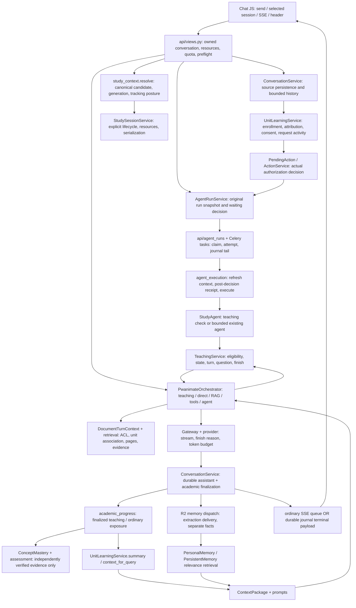

# SRI-01 — Spark end-to-end reliability investigation

Date: 2026-11-14. Scope: PwaniNet/Vasto Spark. Diagnosis only. No application source, migrations, configuration, consent or student records changed. No providers called or services restarted. This milestone precedes remaining feature work.

## Executive findings

1. **CONFIRMED, current source and disposable reproduction:** post-consent execution has two source identities. `agent_execution.execute_claimed` creates a prospective `execution_boundary_id`, but its ordinary completion passes the original `run.user_message_id` to finalization. For an attributed academic question outside `TeachingService.applies`' narrow teaching-verb matcher, an authorized activity exists on the new boundary while `finalize_ordinary` looks at the pre-consent source and creates no turn. An offline fixture produced `(original activities, boundary activities, turns) = (0, 1, 0)` and run status `completed`. This is a real current capture gap; it is not evidence that this exact path handled the owner's OOP exchange.
2. **CONFIRMED, current source and offline helper reproduction:** durable SSE reconstruction drops the completed teaching segment when a run pauses again for a question. `_terminal_payload` returns the interaction but neither `answer` nor `metadata.teaching` for waiting runs, even with `result_message_id`. `_resumeChatPayload` needs both to display that lesson segment. `OrchestrationResponse.to_dict` also blanks all awaiting answers. The synchronous service test can persist a lesson successfully while the browser receives only a question. This is a response-contract failure, not proof that the provider stopped early.
3. **CONFIRMED, current source and offline provider-parser reproduction:** Groq/OpenRouter normalize token exhaustion to `max_tokens`; Gemini lowercases `MAX_TOKENS` to `max_tokens`. `_needs_continuation` recognizes only `length`/`interrupted`; teaching and ordinary completion guards omit `max_tokens`. A partial Groq fixture skipped continuation and passed the completion predicate. Durable runs also transition to completed without checking finish reason. Known partial output can therefore be represented as success and, with otherwise valid provenance, recorded as completed learning.
4. **CONFIRMED historical code boundary:** committed digest-backed welcome and raw-transcript recall have been removed from the working tree. `StudyMemoryService.refresh` now returns false and `welcome` always returns generic suggestions. `ConversationMemoryService.search` now retrieves approved facts only. This is deliberate consent-policy narrowing, but no equivalent bounded, authorized recent-session greeting context replaces it. Academic retrieval requires a named unit or continuity wording, so a bare greeting supplies no academic history. `_run_conversational` does accept memory and academic context: blanket claims that it discards all memory are false.
5. **CONFIRMED matcher limitation:** “Wagwan Spark, how are you?” and “hi Spark, how are you?” miss `is_conversational_intent`; “hello” matches. Active Study Mode or selected resources also bypass the lightweight conversational branch. These permit unnecessary planning/retrieval for casual conversation. Exact live route for the owner's greeting is unavailable.
6. **UNVERIFIED for the new OOP observation:** a missing header does not establish an absent backend session. Current canonical reads and the dedicated run-bound consent-card handler can refresh the header. Other decision routes lack the same explicit refresh and response metadata. The actual OOP action/run/session IDs, browser assets and loaded worker version are unavailable in this execution environment.

**Shared causes:** incomplete propagation of post-consent execution identity and result metadata across service → durable run → SSE → UI; incompatible definitions of response completion across providers and consumers. **Independent cause:** intentional memory-policy replacement without an authorized lightweight continuity replacement, compounded by narrow casual routing. Historical SMA B203 capture failed earlier than persistence, as documented below; it must not be conflated with the newly reproduced source-identity gap.

## Evidence levels and investigation limits

CONFIRMED means directly inspected source, Git diff, executed offline fixture or explicitly identified historical evidence. PROBABLE means code supports a mechanism but the decisive live trace is missing. UNVERIFIED means insufficient evidence. A confirmed source defect is not automatically a confirmed cause of the owner's observation.

Current environment exposes the checkout and an isolated process namespace. `/proc` inspection found the Codex process, its shell and the investigation interpreter, with no visible web/Celery/PostgreSQL processes. Browser inventory returned `apps: []`, `browsers: []`. Thus no current browser, live account context, provider trace or in-memory web/worker module could be inspected. No current live database query was issued: there was no identified authorized target owner/account in this namespace. No broad account search or write-capable “read” service was substituted. In particular, `PersistentMemoryService.retrieve` updates `last_accessed_at`, some preference helpers create rows, and `AgentRunView.get` invokes recovery writes. They are unsuitable for an unrestricted production read-only probe.

Earlier live investigation evidence is available in `docs/spark/sals/stabilization/PHASE_B_LIVE_CAPTURE_DIAGNOSIS.md` and its existing `/tmp/phase_b_live_readonly.py` helper. Its reported read-only transaction and redacted findings are **historical evidence, not a fresh SRI-01 DB verification**. The current owner's OOP and Java-cutoff observations have no accessible correlated row/trace set. Exact historical prompts/provider output cannot be reconstructed.

## Historical regression reconstruction

### Committed baseline

HEAD is `6d17e49a8d64f7050992fd6a11e758b02291ae74`, “feat: Implemented SPark's agent orchestrator.”, 2026-11-11 21:25:53 +0300. Relevant history also includes `45c8583` (2026-10-26), `1085a87` (2026-10-23), and earlier Study Mode work. The initial checkout had 164 changed/untracked status entries. SALS services, migrations 0027–0038 and most milestone reports are untracked; many existing runtime files are modified. These are development changes, not individually attributable release commits. No commit hash or deployment date can honestly be assigned to each SALS repair from this history.

`git show HEAD:pwanimate/services/study_memory.py` shows `refresh` summarizing the latest 16 turns with a bounded summary-model call, persisting topic/summary/next step/welcome, and `welcome` selecting the owner's latest permitted digest. `git show HEAD:pwanimate/services/conversation_memory.py` shows owner-scoped message-vector search plus lexical transcript fallback, reset filtering and an enabled-memory preference. Orchestrator conversational, tool and RAG paths injected those search results via ContextPackage. This proves the old capability existed; it does not prove every greeting successfully used it.

Before WP4, Start Study / leading `@study`, explicit study flags/session ID or a directly active home-conversation session activated Study Mode. `StudySessionService` owned checkpoints, bounded dialogue, resources, pause/resume and summaries. The session home relation controlled much of UI restoration. A study session was neither enrollment-linked authorization nor mastery.

### Documented development sequence and current verification

- `docs/spark/PERSISTENT_MEMORY_PHASE1.md`, `SALS_0_1_VERIFICATION_REPORT.md`, and `sals/audit/SALS_DATA_AND_MEMORY_AUDIT.md`: raw transcript/vector/digest recall quarantined in favor of consented approved facts; memory starts disabled, academic extraction is separately consented, recall relevance/budget/cutoffs enforced. Current `conversation_memory.py`, `personal_memory.py`, `persistent_memory.py`, `study_memory.py` corroborate the replacement. Earlier broad continuity was narrowed intentionally; restoring arbitrary transcript recall would violate the current policy.
- `docs/spark/SALS_0_2_IMPLEMENTATION_REPORT.md`: student enrollment/unit/semester records and source activities; ask/automatic/disabled tracking; existing PendingAction authorization; **nonblocking consent**, separate from activating legacy Study Mode. Session creation never implied completed learning.
- `docs/spark/SALS_0_3_WP1_REPORT.md`: concept evidence, reviewed assessment binding, assistance/retention/prerequisite requirements. An explanation, self-report or legacy percentage cannot certify mastery.
- `docs/spark/SALS_0_3_WP2_REPORT.md`, `sals/wp2/IMPLEMENTATION_REPORT.md`, `FOLLOW_UP_CONTINUITY_IMPLEMENTATION_REPORT.md`: persisted teaching state/turns, phase transitions, original-run questions, short-reply offers; early follow-up implementation could consume an offer without execution.
- `sals/stabilization/R1_FOLLOWUP_REPAIR_REPORT.md`: durable claims, execution results and existing executor now required; uncertain interrupted work fenced. Current `followups.py::execute_follow_up_action` delegates to existing execution and does not supply a new orchestrator.
- `sals/stabilization/R2_MEMORY_DISPATCH_REPAIR_REPORT.md`: atomic assistant/outbox intent, bounded dispatch/recovery, revision-fenced processing. Delivery durability does not manufacture academic history or change recall relevance. Earlier lost jobs are not automatically backfilled.
- `sals/stabilization/ACADEMIC_CONTINUITY_PHASE_B_REPORT.md`: early optional consent, prospective source-time capture, academic binding, assistant-linked completion and summary projection. PostgreSQL self-row lock fixes followed. Nonblocking initial lessons could remain untracked even if their answers arrived after approval.
- `sals/stabilization/PHASE_B_LIVE_CAPTURE_DIAGNOSIS.md`: actual empty SMA B203 record; initial source before approval, then an unattributed interruption complaint. No finalization attempt was established because no eligible activity/turn existed.
- `sals/wp4/UNIFIED_STUDY_MODE_ARCHITECTURE.md`: sections 1–9 are historical audit/design; section 10 supersedes them with implementation. Current `study_context.py` supplies canonical selection, explicit ambiguity/handoff and generation. Do not quote the earlier A/B-selector defects as though unchanged in current code.
- `sals/wp4/IMPLEMENTATION_REPORT.md`: consent now holds the requested lesson on its original durable run, creates a prospective execution receipt after decision, supports document attribution and canonical lifecycle fences. Later hotfix establishes parent-first lock ordering. Current source corroborates implementation, but the observed response-boundary gaps remain.
- `sals/consent-composer/IMPLEMENTATION_REPORT.md`, `sals/STABILIZATION_REPORT.md`, `sals/wp3/RUNTIME_PIPELINE_AUDIT_AND_REUSE_ANALYSIS.md`: interactive controls reuse existing components; typed/mixed questions merge above the composer, consent is a PendingAction, truthful activity and direct/RAG fast paths avoid unnecessary planning. Current code still has separate consent-card, generic action and interaction submission paths.

Most likely regression boundaries are **working-tree memory quarantine** for diminished welcome/recall, and **WP4 prospective execution receipt plus durable continuation transport** for new consent/capture inconsistencies. Finish-reason normalization and completion predicates span provider/orchestration/Phase B/WP4 changes; Git cannot establish their exact introduction order here.

## Single execution and ownership map

Decision ownership and consumers:

- `static/js/pwanimate/pwanimate-chat.js` owns local `activeStudySession`, `studySessionId`, `studyModeActive`, interaction state and rendering. `spark-study-sessions.js` owns the existing desktop/mobile session surfaces; `spark-study-desk.js` settings/memory surfaces; `spark-unit-learning.js` record/history controls. None authorizes capture.
- `study_context.py::resolve/select/lifecycle_target/fence_run` owns canonical identity and selection/lifecycle fences; chat validation, teaching, lifecycle endpoints, serializers, views and restoration consume it. A read may infer one candidate without persisting the nullable pointer. Multiple candidates require explicit selection; selection increments generation and parks peers.
- `unit_learning.py::detect/document_match/contextual_match/scoped_attribution/process_message/approve_action` owns attribution and authorization, independent of display state. `TeachingService.applies/prepare` consumes those checks but adds a teaching-route matcher.
- `agent_runs.py::pause/decide`, `agent_execution.py::claim_run/execute_claimed`, `tasks/agent_runs.py::execute_agent_run`, `agent_journal.py` own original run, exact actions/questions, attempts and durable results. R1 followups are consumers, not a separate engine.
- `academic_progress.py::finalize/finalize_ordinary/progress_summary` links eligible completed assistant output to learning. `assessment.py` and `concept_mastery.py` remain sole formal assessment/mastery authorities.
- `conversation_memory.py::search` → `PersonalMemoryService.recall` → `PersistentMemoryService.retrieve` supplies approved facts. R2 `memory_dispatch.py`/`tasks/conversation_memory.py` delivers extraction independently. `ContextPackage.format_context_text` and orchestrator `_apply_study_and_warning_context` assemble answer context; StudyAgent also receives bounded memory/academic records in planner JSON.
- `orchestrator/document_context.py` resolves resource identity/ACL/page diagnostics; `retrieval/services/document_retrieval.py` and document access policy supply actual evidence. Selected resources are neither enrollment nor completed learning.

## A/B — Consent, activation and interaction trace

### Current product contract

Start Study remains possible without tracking. Tracking approval is a separate prospective authorization. For a **fresh current WP4 held lesson**, approval also creates/reuses a compatible session and permits the original requested lesson to execute; an active selected session should be reflected in the header. For an already paused session, granting/renewing consent does **not** resume it. Ambiguity requires handoff. The card summary still describes “future activity”; the held-turn prompt says Start Tracking begins this lesson. That distinction should be visible and consistent, rather than implying every grant automatically resumes Study Mode.

`api/views.py:698–858` persists the input, identifies proposals and pauses before generation. `AgentRunService.decide` validates action ownership, generation and lifecycle, then `ActionService.confirm` calls `UnitLearningService.approve_action`. Approval stores record authorization/revision/conversation and returns `record_id`, `session_id`, `tracking_from`, `historical_content_imported: false`. `_session` reuses compatible active canonical sessions; paused selected sessions remain paused. No automatic backfill occurs.

No dedicated Study Mode lifecycle SSE event is published by `approve_action`; it returns identity in the action result. `execute_claimed` emits decision activity, not a canonical-session envelope. `_terminal_payload` returns no study context/session. The dedicated `_academicTrackingBlock` run-bound handler explicitly calls `refreshStudyContext` after resume. `refreshAcademicTracking` also begins with canonical refresh. Thus the current source has a valid refresh path and cannot alone prove header failure.

Other paths are uneven: the standalone card success removes itself without immediate canonical refresh; generic `decideAction` updates only its action card; activity-trail approval calls `resumeAgent` directly, and the re-paused branch of `_resumeChatPayload` does not refresh the canonical context. The nonwaiting branch calls `refreshConversationsList`, which invokes academic/canonical refresh. This makes header activation dependent on presentation path and whether execution re-pauses. **CONFIRMED contract asymmetry; PROBABLE contributor to A, unverified for the owner's exact control.**

`syncStudyModeUI` at chat JS:824 shows the banner when `activeStudySession.id` exists or `studyModeActive` is true. Current `refreshStudyContext` at :8296 obtains canonical identity and detail, then sets these fields. The header is therefore not exclusively driven by the old home relation. A missing header does not prove the backend row is absent. On ambiguous/no-session replies this helper does not uniformly clear all old session fields; fetch/JSON/conversation-switch timing also needs browser coverage. A conversation-ID guard occurs before `response.json()` and again after detail fetch; it is not full generation/version fencing of every UI mutation.

### Placement and decision integrity

Current `_academicTrackingBlock` appends a PendingAction control in transcript/bubble; `_syncInteractionBlock` inserts a pending SparkAgentInteraction immediately above the composer. These share styling but have different authorities. A visually similar composer block is not sufficient evidence that it represents tracking consent. Its action/interaction ID, run ID and submitted endpoint must be inspected. This is **UNVERIFIED** for B: no screenshot/DOM/network trace of the reported control is available.

`_showAcademicPreflight` includes owning run IDs; restored `ActionService.serialize` attaches waiting-run identity. Dedicated card handlers disable repeat clicks, retain errors and remove successful cards. Poll restoration deduplicates action IDs and removes resolved/expired cards. Interaction signatures include run+interaction ID, and draft cleanup is explicit. Existing tests cover individual handlers but do not establish desktop/mobile decision → original run → teaching segment → header success. A replaced local panel can leave a server question parked, which is intentional only when explicitly communicated; it must never submit an unrelated action.

### First broken transitions

- A: **not located in the actual OOP journey**; obtain canonical GET, action result, resumed terminal SSE and header fields from the same browser request. Backend absence, paused state, ambiguity, stale generation, stale assets and stale workers remain distinguishable hypotheses.
- B: relocation alone is not a confirmed defect. Current durable consent is a PendingAction, not an arbitrary confirm question. First actual incorrect binding/submission, if any, remains unverified.
- Independently confirmed current resumed teaching failure: persistence → terminal SSE loses the completed segment and teaching metadata when a question remains waiting. See C.

## D — Teaching capture and the first missing event

### Current reproducible source-identity failure

Offline disposable fixture SRI-F2 used existing `setup_mastery` enrollment factories and a fresh conversation, then requested “What is a vector space in [fixture enrolled unit name]?” through the real `_post_chat` preflight. It held a consent run. Real `AgentRunService.decide` approved the actual PendingAction. `execute_claimed` created one internal post-decision input, with one authorized activity; original input had none. Real `TeachingService.applies` returned false: the snapshot omits study_mode/study_context and the question contains none of the teaching-route verbs. The fixture mocked general answer generation to return nonempty `stop` output and invoked real assistant persistence/finalization. No provider was called.

`agent_execution.py:223` passes `continuation.answer_message_id or run.user_message_id`, ignoring the new execution boundary. `academic_progress.py::finalize_ordinary` finds no eligible activity for that old source and returns. Result: one authorized **request observation**, zero completed exposure/teaching turns, run `completed`. This confirms a failure under the ordinary route, not a failure of `TeachingService.prepare`'s boundary receipt: prepare correctly keys its receipt with `execution_boundary_id or user_message_id` at teaching.py:479.

Existing `tests/sals_wp4/test_unified.py::test_consent_holds_then_original_run_executes_after_approval` uses an explicitly recognized “Explain…” deterministic lesson and directly consumes `execute_claimed` output; it does not exercise this question form or HTTP durable-tail serialization. Passing that test cannot certify the uncovered transitions.

### Historical failed student journey, secondary evidence

The earlier live diagnosis provides this UTC timeline, aliases only: owner O, record R, enrolled SMA B203, conversation C-new, session S-new, source M1, assistant M2, complaint M3, assistant M4. Do not interpret these aliases as newly inspected IDs.

1. **00:12:44.811394:** M1 persisted, recognized enrolled subject, no current source-time authorization.
2. **00:12:45.079266:** PendingAction proposed for M1; no authorized unit activity.
3. **00:12:55.310751:** tracking authorized for C-new, revision 0.
4. **00:12:55.420819:** S-new created active and academically bound; approval retained `historical_content_imported: false`.
5. **00:12:56.374875:** M2 persisted; historical trace says `routine_tutoring_direct`, not teaching. M1 remains pre-consent.
6. **00:13:34.908068:** M3 reports interrupted output without a topic. Its detection/meaningful gate and teaching attribution fail despite correct selected session/current authorization.
7. **00:13:43.713288:** M4 persisted by RAG. No eligible source activity exists for ordinary completion.

At that historical inspection: zero unit activities, teaching states, teaching turns, assessments and concept evidence; zero agent runs in that target conversation. Summary/API/context projection faithfully showed emptiness. First missing transition was input eligibility/attribution, not a hidden finalized row or failed completion lock. This confirms neither the current OOP path nor its deployment version. WP4 changes first-consent behavior, but its bounded contextual matcher still excludes a cutoff complaint and requires an existing finalized turn.

### Evidence semantics to preserve

Session creation is lifecycle only; tracking approval grants future writes; SparkUnitActivity records a request/self-report. An authorized ordinary answer is only topic exposure. A teaching explanation completes only with durable assistant/source provenance and eligible finish status. Assigned practice is an outgoing owned question, submitted attempt an answered interaction, feedback an evaluated outcome. Formal assessment and independent verified concept mastery require WP1 provenance/policy; no document retrieval, explanation, consent receipt or Celery completion can substitute. Do not backfill either historical student exchange.

## C — Streaming, truncation and recovery

### Actual paths

Ordinary initial turns: provider streaming adapter → gateway `generate_stream` → orchestrator `_generate` → `on_token` → `_stream_chat_response` in-process queue → SSE chunk → browser `readChatEventStream` → batched Markdown rendering. Final assistant persistence and response serialization precede the terminal `response` event; final data replaces the transient streaming row. Disconnect does not cancel the background request thread automatically, but it also does not create a durable run for every ordinary turn. Reload may recover a persisted answer, not arbitrary lost token chunks.

Resumed runs: claim/attempt → Celery `execute_agent_run` → `execute_claimed` → journal activity and persisted assistant/result pointer → `_stream_run_events` polling → `_terminal_payload`. Token deltas are deliberately not journaled and the worker runs without token callback. Resumed output normally arrives as a final persisted segment. “No live tokens” on this route is not provider truncation.

### Confirmed breaks

- **SRI-F1 finish vocabulary:** Groq `_parse_response` (:382–391), OpenRouter (:362–371), Gemini (:358) emit `max_tokens`. Orchestrator `_needs_continuation` (:1407) recognizes `length`/`interrupted`. Teaching finish (:720), initial API completion (:912) and resumed completion (:224) use a negative set missing `max_tokens`. Fixture: partial content, raw `length` → `max_tokens`; continuation false; completion predicate true. Gateway does not normalize that mismatch away.
- **SRI-F3 lost waiting result:** `api/agent_runs.py::_terminal_payload` only loads result content when status is not waiting; waiting returns question/awaiting metadata. Offline fake waiting run with a result pointer yielded keys `activity, interaction, metadata, run_id, status`, with no answer or teaching metadata. Browser `_resumeChatPayload` (:7513) requires `metadata.teaching && answer` to display the segment. `OrchestrationResponse.to_dict` also blanks awaiting output. Thus full persisted content can be absent from the response/UI even with a healthy provider.
- **Run-success mismatch:** `execute_claimed` marks any nonawaiting running run completed regardless of finish reason. Academic capture may reject `length`/`interrupted`, yet the run still claims completion. `max_tokens` may bypass both checks. Celery's wrapper returns `{status: error}` on exceptions after attempting to mark failed; Celery backend SUCCESS only means the task returned. It is not application success.
- **Missing terminal attestation:** provider adapters default absent finish marker to stop/STOP after stream iterator EOF (Groq :267, OpenRouter :274, Gemini :235). Exceptions after visible output become `interrupted` in gateway, which is useful, but a clean EOF without terminal reason can appear completed. This mechanism is confirmed in source; its occurrence in the owner's response is unverified.

`_generate` attempts at most one continuation for recognized partial states. A failed continuation preserves partial content and original finish reason. It does not repair the vocabulary mismatch. Cancellation is checked before final generation in execute_claimed; in-flight cancellation/lifecycle changes and lease expiry still need end-to-end final-result fencing coverage. Academic finalization rechecks active/selected authorization, so a dialogue answer can persist without earning learning progress after pause/revocation.

### What cannot be concluded about the Java example

No provider request ID, finish reason, token usage/budget, server output length/hash, persisted content length/hash or browser final raw content is available for that example. Provider exhaustion, server interruption, SSE truncation, hidden waiting segment and rendering loss remain separate possibilities. `PwanimateTurnTrace` records timing/intent/retrieval/memory but the inspected initial writer does not store finish reason; assistant rows do not retain it as a dedicated completion field. Durable-tail payload reconstruction also loses finish reason/teaching metadata. Do not assign the provider as cause or certify a persisted partial answer as completed learning.

For a future privacy-safe correlation, compare owner-scoped character counts and SHA-256 hashes of final provider-normalized content, persisted assistant content and browser `data-raw`; inspect only a minimally necessary redacted terminal fragment if hashes differ. Correlate request, message, action, run, attempt, boundary, session/generation, record and teaching receipt aliases. Do not log full prompts or private reasoning.

## E/F — Cross-chat recall and lightweight greetings

`UnitLearningService.context_for_query` (:428) reads owner records, bounded to 100 candidates. Named unit/code/term can select authorized historical records even when new ask-mode writes are not permitted. Generic continuity wording selects a unique currently eligible/revision-authorized record or returns clarification. Disabled academic preference suppresses model recall while owner record inspection retains history. Inactive conversation-scoped write permission is not deletion.

`summary`/`academic_progress.progress_summary` project finalized turns (30), sources/citations, outstanding interactions and verified evidence, separately from request activities and approved self-reports. `ContextPackage.format_context_text` (:527) includes escaped academic history limited to 18,000 serialized characters. This can bound older/detail context but is not evidence of dropping the OOP record. For historical SMA B203 raw records were absent and the empty projection was accurate. For OOP raw absence versus filtering/misbinding/model disregard is **UNVERIFIED**.

Greeting continuity first loses its old welcome source at `StudyMemoryService.welcome/refresh`; the committed behavior and current diff prove that removal. For a new-chat bare greeting, `context_for_query` has no named unit/continuity trigger and supplies no recent academic activity. Fact retrieval is lexical by default, vector opt-in, approved/owner/consent bounded (typically 600 tokens); greeting words need not overlap a saved study fact or response preference. A session can exist without a fact about it. R2 delivery cannot fix that relevance/selection boundary.

`_run_conversational` (:1504) preserves current dialogue history, user context, conversation_memory, academic_unit_context and verified tracking posture. It does not independently retrieve latest paused sessions. Study context is applied only when request.study_mode is true; that very flag disables the lightweight conversational route earlier. StudyAgent receives broader personal-study inventories and bounded memory but reintroducing it for every greeting would recreate expensive over-investigation. Profile assistant preferences still exist via UserContextService; relevant approved response preferences can be lost upstream to query relevance, not necessarily prompt rejection.

Desired repair is one brief casual route with bounded read-only authorized recent-session metadata, explicit ambiguity/recency and optional grounded suggestion. It must make no document/tool/planner calls and must not activate a session or grant writes. A recorded request, paused session, completed explanation and mastered concept must be described accurately as different facts. No recent authorized activity means no invented suggestion.

## Runtime/deployment consistency

- **Verified here:** HEAD and working-tree differences, current source DTO contains optional `execution_boundary_id` at orchestrator/types.py:34; SNAPSHOT_FIELDS includes it; execute_claimed reconstructs with `OrchestrationRequest(**snapshot)`. Both project interpreter paths exist; offline probes used `.venv/bin/python` with `tests.spark_memory.settings`, not deployed settings.
- **Not verified here:** applied live migrations, DB identity, current web/worker executable/start time, loaded module bytecode, worker queues/beat, actual frontend URL/body/cache headers, current authenticated browser. No web/worker process exists in the visible namespace; this does not mean the owner's services are stopped.
- **Historical only:** Phase B diagnosis reported local-settings web interpreter `venv`, migration 0037 applied, web child newer than locking hotfix, workers older, no visible separate beat. Its observed student exchange predated the newer web child and used no durable runs. Those timestamps cannot attest today's WP4/0038 deployment.
- **Source routing:** base.py CELERY_TASK_ROUTES routes `pwanimate.tasks.*` to `docs_queue`; memory recovery beat entry runs every minute, run recovery is separately scheduled. `dispatch_run` falls back to an inline daemon thread only on broker publication exception, not on accepted publication with absent/stale consumer. A listening broker is not worker compatibility proof.
- **DTO mismatch:** current disk writer/reader agree on execution_boundary_id. A worker loaded before that field was added can still reject a new snapshot at the constructor. The current source does not version/filter snapshot schemas, so rolling/stale worker mismatch remains possible. No current trace proves it occurred. Same applies to importing OrchestrationRequest from an older module: not reproducible from this checkout's current definitions.
- **Assets:** index.html:64 and base.html:6977 use static URLs plus manual suffixes, but `pwaninet/static_storage.py` and base STORAGES configure content-derived fingerprints. A suffix date alone cannot establish a stale asset. Compare the served asset hash and effective storage/fingerprint against disk; no browser/network cache evidence was available.

Deployment alignment is an evidence prerequisite for owner reproduction, not permission in SRI-01 to restart, migrate or change settings.

## Verification performed

- Four existing Node handler/contract scripts passed: `tests/spark/study-context.cjs`, `unit-learning.cjs`, `lifecycle-resume.cjs`, `composer-interaction.cjs`. These use DOM/fetch fixtures, not real browser acceptance.
- `PYTHONDONTWRITEBYTECODE=1 SPARK_MEMORY_SYNC_SCHEMA=1 DJANGO_SETTINGS_MODULE=tests.spark_memory.settings .venv/bin/python manage.py test tests.sals_wp4.test_unified --noinput --verbosity 0`: **14 tests, OK, one skipped**, 16.002 seconds. PostgreSQL handoff race skipped. Existing Axes isolated-settings warnings and expected negative API logs occurred. Output: `/tmp/sri01-wp4-tests.log`.
- SRI-F1: real Groq response parser plus real `_needs_continuation`, synthetic partial content, no provider or database. Confirmed max_tokens mismatch; greeting regex controls also executed.
- SRI-F2: one temporary in-memory TestCase method using existing UnifiedTests/setup_mastery and MemorySQLiteRunner, real consent/preflight/boundary/assistant finalization, mocked ordinary generation. **One test, OK**, 2.363 seconds. Output: `/tmp/sri01-boundary-fixture.log`. It asserted the defect, not a passing student workflow. Only synthetic rows in disposable SQLite were created; database destroyed by test runner. No test source was added or modified.
- SRI-F3: real `_terminal_payload` with fake waiting run and mocked serialization, no DB/provider. Confirmed absent answer/teaching metadata.

No PostgreSQL/Docker suites, owner DB migrations, browser acceptance, live providers or infrastructure failure injection executed. Owner-reported 353-test WP4 success is recorded as owner evidence only; no transcript was independently verified and it does not certify full browser behavior.

## Remaining evidence gates

Obtain one minimally scoped OOP journey with authenticated owner scope and enforced PostgreSQL read-only transaction (`default_transaction_read_only=on`, repeatable-read/read-only verification, rollback): alias the message/action/boundary/session/generation/record/run/attempt/turn/result chain; count eligible raw activities/turns before evaluating projection. Use direct owner-filtered ORM reads, not mutating preference/recall/recovery helpers. Read only target fields/records; no backfill or replay.

For the same journey, capture existing browser control identity, request payload, action outcomes, canonical GET and terminal SSE, served JS fingerprint and header fields. A safe read-only page should not trigger write-on-read recovery. Preserve redacted response status/finish metadata, not full student content. Attest web and workers against one release and schema before a later owner-authorized acceptance run. Actual student generation/consent/resume is a separate future acceptance action, not part of this diagnosis.

## Roadmap preserved

Pending: Phase B live academic continuity acceptance; WP4 real-browser unified Study Mode acceptance; R3 Progressive Hint Restraint; R4 Response Quality, Orchestration and Runtime Optimization; R5 End-to-End Student Acceptance; WP4 study-summary/revision-document follow-on acceptance/work still pending; SALS 0.4 Academic Content Intelligence; SALS 0.5 Quizzes, Assignments and Mock Exams; later student-progress/revision features; separate Vasto-wide Lucide icon migration. Existing partial hint/quality fixes do not complete those milestones. SRI-01 cancels or marks complete none of them.
